# SƠ ĐỒ PHÂN RÃ CHỨC NĂNG TỔNG QUÁT (FDD CẤP 0, 1, 2)
## (High-Level Functional Decomposition Diagram)

Sơ đồ phân rã chức năng (Functional Decomposition Diagram – FDD) thể hiện cấu trúc phân cấp từ toàn bộ hệ thống OmPraMani xuống 7 nhóm nghiệp vụ chính (Cấp 1), 17 module chức năng thực tế (Cấp 2) và liên kết đến các chức năng cụ thể (Cấp 3).

```mermaid
flowchart TD
    classDef root fill:#4a148c,stroke:#311b92,stroke-width:2px,color:#ffffff;
    classDef l1 fill:#1565c0,stroke:#0d47a1,stroke-width:2px,color:#ffffff;
    classDef l2 fill:#00695c,stroke:#004d40,stroke-width:1.5px,color:#ffffff;
    classDef l3 fill:#f5f5f5,stroke:#424242,stroke-width:1px,color:#212121;

    SYS["HỆ THỐNG OMPRAMANI<br>(Nền tảng số hóa Phật giáo)"]:::root

    %% CẤP 1: 7 NHÓM CHỨC NĂNG LỚN
    G1["1. PHÂN HỆ QUẢN LÝ TÀI KHOẢN & BẢO MẬT"]:::l1
    G2["2. PHÂN HỆ NỘI DUNG & KHO TÀNG PHẬT HỌC"]:::l1
    G3["3. PHÂN HỆ CÔNG CỤ HÀNH TRÌ TU TẬP"]:::l1
    G4["4. PHÂN HỆ KẾ HOẠCH & THEO DÕI TIẾN ĐỘ"]:::l1
    G5["5. PHÂN HỆ CỘNG ĐỒNG & KHÔNG GIAN TÂM LINH"]:::l1
    G6["6. PHÂN HỆ LỊCH & TRA CỨU ĐỊA ĐIỂM"]:::l1
    G7["7. PHÂN HỆ THƯƠNG MẠI PHÁP BẢO & QUẢN TRỊ"]:::l1

    SYS --> G1
    SYS --> G2
    SYS --> G3
    SYS --> G4
    SYS --> G5
    SYS --> G6
    SYS --> G7

    %% CẤP 2: CÁC MODULE
    %% Nhóm 1
    G1 --> M01["M01. Xác thực & Hồ sơ cá nhân (IAM)"]:::l2

    %% Nhóm 2
    G2 --> M02["M02. Kinh điển & Thư viện đọc kinh"]:::l2
    G2 --> M03["M03. Số hóa văn bản kinh (Ingestion)"]:::l2
    G2 --> M04["M04. Tra cứu Phật & Bồ Tát"]:::l2
    G2 --> M05["M05. Thần chú & Trì niệm"]:::l2
    G2 --> M14["M14. Bài viết giáo lý & Video Phật pháp"]:::l2

    %% Nhóm 3
    G3 --> M06["M06. Phiên tu tập & Chuông Mõ điện tử"]:::l2
    G3 --> M07["M07. Thực hành Thiền định"]:::l2
    G3 --> M08["M08. Tràng hạt điện tử (Client-only)"]:::l2

    %% Nhóm 4
    G4 --> M09["M09. Kế hoạch & Nhắc nhở tu tập"]:::l2
    G4 --> M10["M10. Hành trình tu học & Chuỗi ngày (Streak)"]:::l2

    %% Nhóm 5
    G5 --> M11["M11. Lời nguyện & Phòng cầu nguyện chung"]:::l2

    %% Nhóm 6
    G6 --> M12["M12. Lịch Vạn Niên & Nông lịch truyền thống"]:::l2
    G6 --> M13["M13. Danh bạ Chùa & Tu viện"]:::l2
    G6 --> M15["M15. Công cụ Tìm kiếm toàn cục"]:::l2

    %% Nhóm 7
    G7 --> M16["M16. Cửa hàng Phật phẩm & Thanh toán SePay"]:::l2
    G7 --> M17["M17. Bảng Quản trị Hệ thống (Filament Admin)"]:::l2
```

---

## Bảng phân cấp Nhóm và Module tương ứng

| STT | Phân hệ (Cấp 1) | Module thành phần (Cấp 2) | Mục đích nghiệp vụ cốt lõi |
| :---: | :--- | :--- | :--- |
| **1** | Quản lý Tài khoản & Bảo mật | **M01.** Xác thực & Bảo mật (IAM) | Quản lý định danh người dùng qua Laravel Sanctum, phiên cookie an toàn, xác thực email và quản lý hồ sơ cá nhân. |
| **2** | Nội dung & Kho tàng Phật học | **M02.** Kinh điển & Tủ sách **M03.** Số hóa Kinh điển (Admin) **M04.** Phật & Bồ Tát **M05.** Thần chú & Trì tụng **M14.** Bài viết & Video | Hệ thống quản lý tri thức Phật giáo chuẩn mực, nhập liệu tài liệu Word/PDF phân tích cây mục lục, liên kết thần chú và video giảng pháp. |
| **3** | Công cụ Hành trì Tu tập | **M06.** Phiên tu tập & Chuông mõ **M07.** Thiền định **M08.** Tràng hạt 108 hạt | Các công cụ số hóa bổ trợ hành trì hàng ngày: chuông mõ âm thanh thực, đồng hồ thiền chuông xoay, tràng hạt số haptic. |
| **4** | Kế hoạch & Theo dõi Tiến độ | **M09.** Kế hoạch & Nhắc nhở **M10.** Hành trình tu học & Streak | Lập lịch thời khóa công phu, gửi thông báo theo scheduler nền, tính chuỗi tu tập liên tục và thống kê thời lượng tu học. |
| **5** | Cộng đồng & Không gian Tâm linh | **M11.** Cầu nguyện & Phòng trực tuyến | Đăng lời nguyện trợ duyên, tham gia thắp nến đồng cầu nguyện, phòng giao lưu tâm linh trực tuyến (Polling) và kiểm duyệt an toàn. |
| **6** | Lịch & Tra cứu Địa điểm | **M12.** Lịch Vạn Niên & Nông lịch **M13.** Danh bạ Chùa & Tu viện **M15.** Tìm kiếm toàn cục | Đổi ngày Âm - Dương theo thuật toán thiên văn Việt Nam, tra cứu ngày tốt xấu (Hoàng Đạo/Hắc Đạo), tìm kiếm chùa theo vị trí và tìm kiếm đa thực thể. |
| **7** | Thương mại Pháp bảo & Quản trị | **M16.** Cửa hàng & SePay VietQR **M17.** Quản trị Hệ thống Filament | Cung cấp pháp bảo, kiểm duyệt chống mê tín dị đoan, thanh toán ngân hàng tự động qua SePay SDK, quản trị nội dung CMS. |
