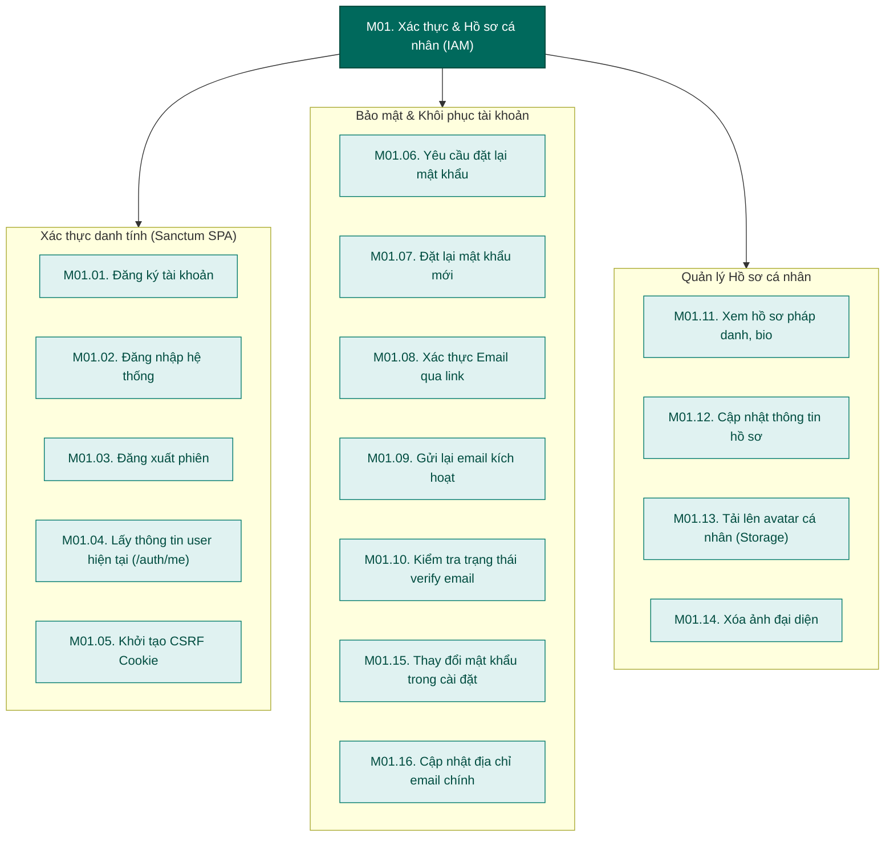
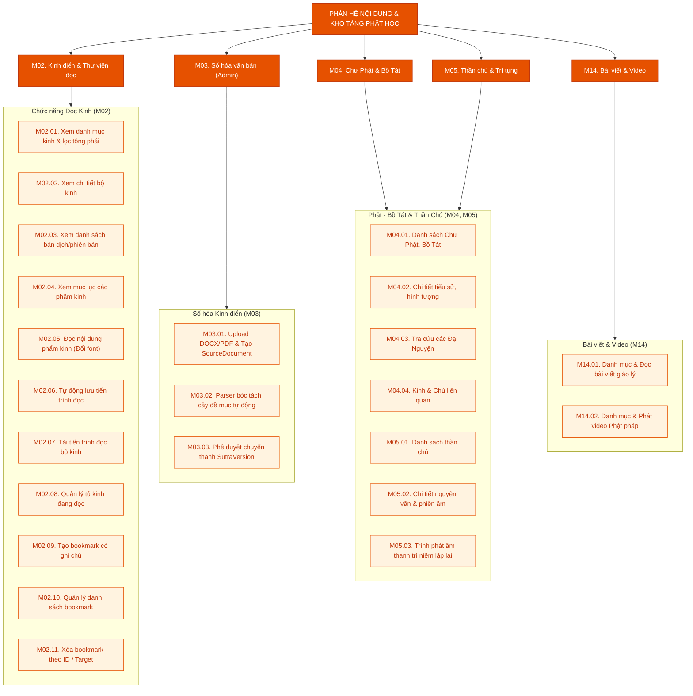
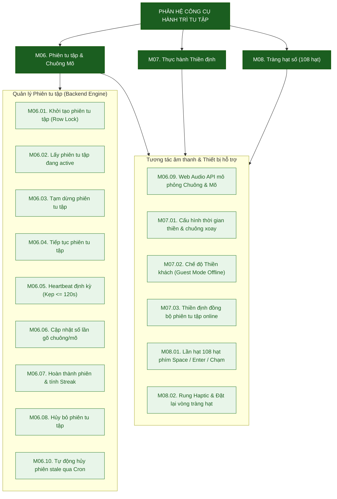
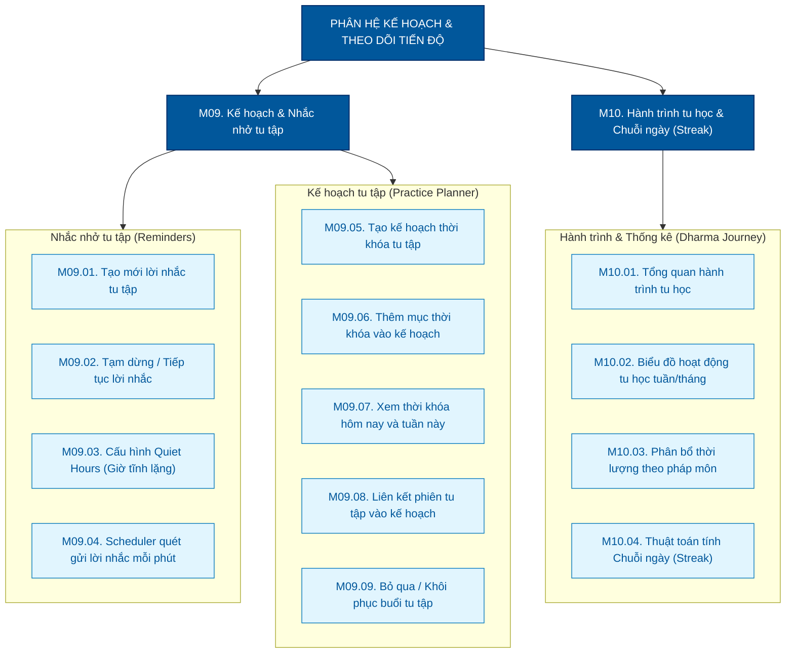
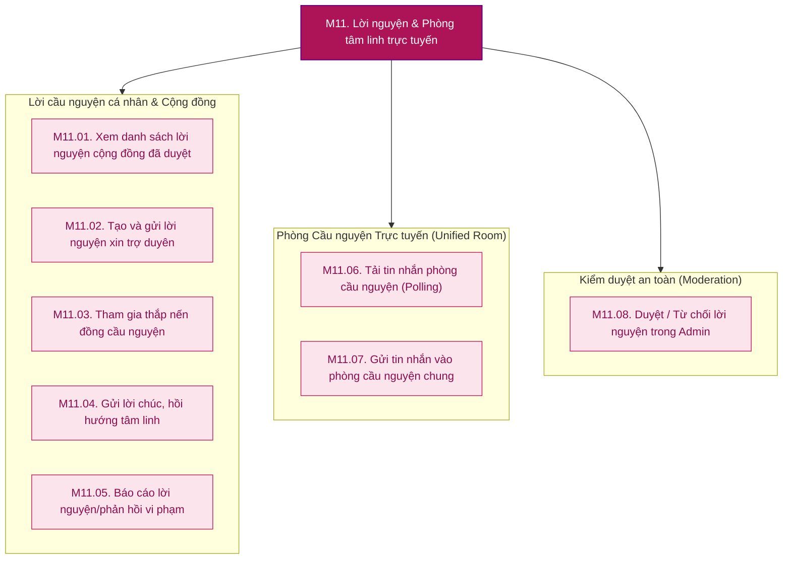
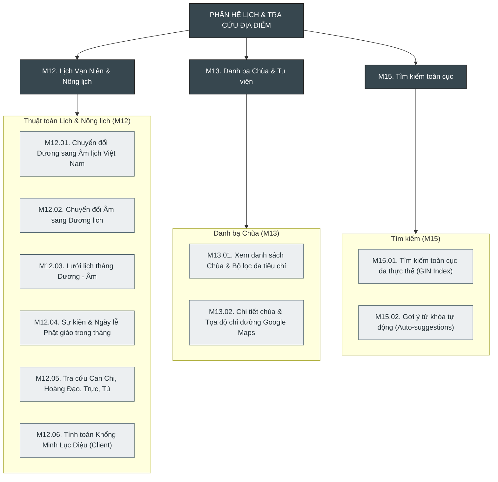
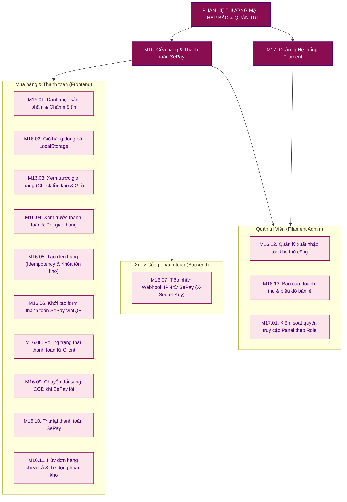

# SƠ ĐỒ PHÂN RÃ CHỨC NĂNG CHI TIẾT (FDD CẤP 2 VÀ CẤP 3)
## (Detailed Functional Decomposition per Domain Group)

Tài liệu này chi tiết hóa từng phân hệ lớn thành các module và chức năng nghiệp vụ cụ thể (Cấp 3) kèm mã định danh chuẩn xác theo source code thực tế.

---

### 1. Phân hệ Quản lý Tài khoản & Bảo mật (M01)

---

### 2. Phân hệ Nội dung & Kho tàng Phật học (M02, M03, M04, M05, M14)

---

### 3. Phân hệ Công cụ Hành trì Tu tập (M06, M07, M08)

---

### 4. Phân hệ Kế hoạch & Theo dõi Tiến độ (M09, M10)

---

### 5. Phân hệ Cộng đồng & Không gian Tâm linh (M11)

---

### 6. Phân hệ Lịch & Tra cứu Địa điểm (M12, M13, M15)

---

### 7. Phân hệ Thương mại Pháp bảo & Quản trị (M16, M17)

