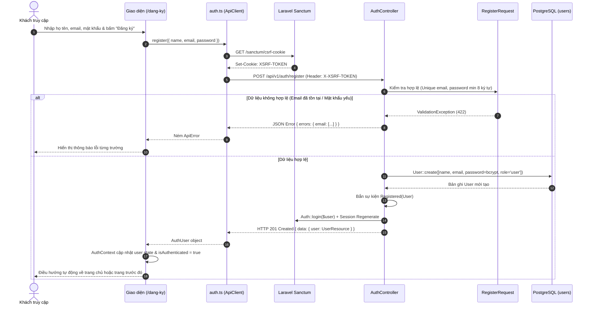

# SƠ ĐỒ TUẦN TỰ: ĐĂNG KÝ TÀI KHOẢN (M01.01)

---

### Thuyết minh nghiệp vụ

**Tên chức năng:** Đăng ký tài khoản người dùng mới.

**Mã chức năng:** M01.01

**Mục đích:** Cho phép khách truy cập tạo tài khoản thành viên để tham gia tu tập, lưu tiến trình đọc kinh, gửi lời cầu nguyện và đặt mua vật phẩm.

**Tác nhân:** Khách truy cập (Guest).

**Điều kiện tiên quyết:** Khách chưa đăng nhập vào hệ thống.

**Luồng xử lý chính:**
1. Khách nhập họ tên, email, mật khẩu tại giao diện `/dang-ky`.
2. Frontend gọi `getCsrfCookie()` để lấy CSRF token từ Laravel Sanctum đảm bảo an toàn phiên.
3. Gửi request `POST /api/v1/auth/register` kèm CSRF token.
4. `RegisterRequest` xác thực tính duy nhất của email và độ dài mật khẩu (tối thiểu 8 ký tự).
5. `AuthController::register` băm mật khẩu bằng Bcrypt 12 vòng, gán quyền mặc định `role = 'user'` (ngăn chặn leo thang đặc quyền).
6. Ghi bản ghi vào bảng `users`, phát sự kiện `Registered`, tự động đăng nhập và tạo mới session ID (`session()->regenerate()`).
7. Trả về thông tin người dùng qua `UserResource` (mã HTTP 201).
8. `AuthContext` cập nhật trạng thái người dùng và điều hướng vào hệ thống.

**Luồng ngoại lệ:**
- Nếu email đã có người đăng ký hoặc mật khẩu không đủ tiêu chuẩn, hệ thống trả về mã lỗi 422 Unprocessable Entity kèm thông điệp chi tiết.

**Kết quả:** Một bản ghi người dùng mới được tạo trong bảng `users`, phiên làm việc được thiết lập tự động.

**Các file source code liên quan:**
- Frontend: `src/app/dang-ky/page.tsx`, `src/lib/api/auth.ts` (hàm `register`), `src/context/AuthContext.tsx`.
- Backend: `app/Http/Controllers/Api/V1/Auth/AuthController.php` (hàm `register`), `app/Http/Requests/Api/V1/Auth/RegisterRequest.php`, `app/Models/User.php`.
