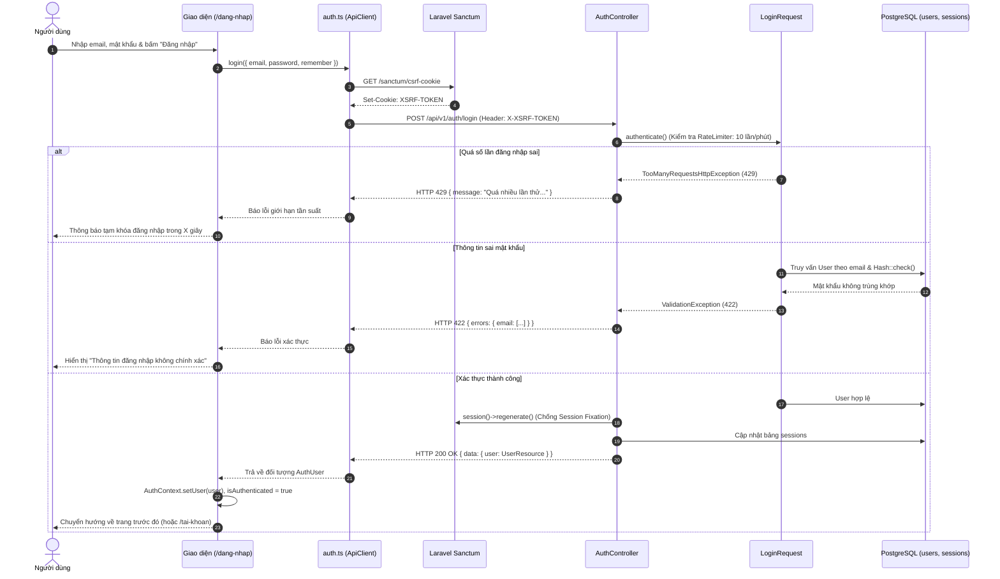

# SƠ ĐỒ TUẦN TỰ: ĐĂNG NHẬP HỆ THỐNG (M01.02)

---

### Thuyết minh nghiệp vụ

**Tên chức năng:** Đăng nhập hệ thống qua Cookie-based Stateful Session.

**Mã chức năng:** M01.02

**Mục đích:** Xác thực danh tính người dùng bằng email và mật khẩu, cấp phiên làm việc có bảo vệ CSRF để sử dụng các tính năng cá nhân hóa.

**Tác nhân:** Khách hoặc Người dùng có tài khoản.

**Điều kiện tiên quyết:** Người dùng đã có tài khoản trên hệ thống.

**Luồng xử lý chính:**
1. Người dùng nhập email và mật khẩu tại `/dang-nhap`.
2. Frontend gọi `getCsrfCookie()` để nhận `XSRF-TOKEN` từ Sanctum.
3. Gửi `POST /api/v1/auth/login` kèm thông tin đăng nhập và header `X-XSRF-TOKEN`.
4. `LoginRequest::authenticate` kiểm tra giới hạn tần suất đăng nhập (tối đa 10 lần/phút theo IP và email).
5. Kiểm tra mật khẩu băm trong database qua `Hash::check()`.
6. Thực hiện đăng nhập (`Auth::attempt`), tái tạo session ID (`session()->regenerate()`) để phòng chống tấn công chiếm đoạt phiên (Session Fixation).
7. Trả về thông tin người dùng định dạng `UserResource` (mã HTTP 200).
8. `AuthContext` lưu trữ thông tin người dùng trong bộ nhớ React và chuyển hướng trang.

**Luồng ngoại lệ:**
- Đăng nhập sai thông tin: Trả về lỗi 422 Unprocessable Entity.
- Thử sai quá 10 lần: Trả về lỗi 429 Too Many Requests, yêu cầu chờ mở khóa.

**Kết quả:** Phiên làm việc được kích hoạt an toàn trong Cookie của trình duyệt.

**Các file source code liên quan:**
- Frontend: `src/app/dang-nhap/page.tsx`, `src/lib/api/auth.ts` (hàm `login`), `src/context/AuthContext.tsx`.
- Backend: `app/Http/Controllers/Api/V1/Auth/AuthController.php` (hàm `login`), `app/Http/Requests/Api/V1/Auth/LoginRequest.php`.
