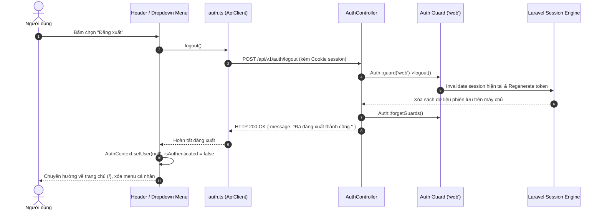

# SƠ ĐỒ TUẦN TỰ: ĐĂNG XUẤT HỆ THỐNG (M01.03)

---

### Thuyết minh nghiệp vụ

**Tên chức năng:** Đăng xuất tài khoản khỏi hệ thống.

**Mã chức năng:** M01.03

**Mục đích:** Xóa bỏ toàn bộ thông tin phiên làm việc của người dùng trên máy chủ và hủy trạng thái xác thực trên giao diện client.

**Tác nhân:** Người dùng đang đăng nhập.

**Điều kiện tiên quyết:** Người dùng có phiên đăng nhập hợp lệ.

**Luồng xử lý chính:**
1. Người dùng bấm nút "Đăng xuất" từ thanh điều hướng `Header.tsx`.
2. Frontend gọi hàm `logout()` gửi `POST /api/v1/auth/logout`.
3. `AuthController::logout` gọi `Auth::guard('web')->logout()`.
4. Hủy bỏ session hiện tại bằng `session()->invalidate()` và tái tạo CSRF token mới `session()->regenerateToken()`.
5. Trả về thông báo thành công mã HTTP 200.
6. `AuthContext` cập nhật `user = null`, `isAuthenticated = false`.
7. Giao diện làm mới trạng thái và điều hướng người dùng về trang chủ.

**Luồng ngoại lệ:**
- Nếu phiên trên server đã hết hạn từ trước (401), Client vẫn xóa sạch trạng thái người dùng trong ứng dụng một cách an toàn.

**Kết quả:** Session và cookie của người dùng trên máy chủ bị hủy hoàn toàn.

**Các file source code liên quan:**
- Frontend: `src/components/layout/Header.tsx`, `src/lib/api/auth.ts`, `src/context/AuthContext.tsx`.
- Backend: `app/Http/Controllers/Api/V1/Auth/AuthController.php` (hàm `logout`).
