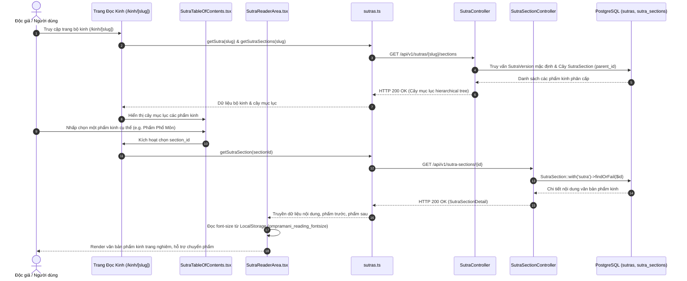

# SƠ ĐỒ TUẦN TỰ: ĐỌC KINH & DUYỆT CÂY MỤC LỤC (M02.04, M02.05)

---

### Thuyết minh nghiệp vụ

**Tên chức năng:** Đọc kinh điển & Duyệt cây mục lục phân cấp.

**Mã chức năng:** M02.04, M02.05

**Mục đích:** Cho phép Phật tử và độc giả tra cứu cấu trúc phẩm/chương của bộ kinh và đọc văn bản kinh điển với giao diện thanh tịnh, tùy biến cỡ chữ.

**Tác nhân:** Khách truy cập hoặc Người dùng đã đăng nhập.

**Điều kiện tiên quyết:** Bộ kinh đã được xuất bản (`status = 'published'`).

**Luồng xử lý chính:**
1. Độc giả mở trang bộ kinh tại `/kinh/[slug]`.
2. Frontend gọi API `GET /api/v1/sutras/{slug}/sections` để lấy cây mục lục.
3. `SutraController::sections` duyệt cây mục lục đệ quy theo các liên kết `parent_id` và thứ tự `position`.
4. `SutraTableOfContents.tsx` render cây mục lục dạng danh mục hoặc accordion.
5. Khi người dùng bấm vào một phẩm kinh, frontend gọi `GET /api/v1/sutra-sections/{id}`.
6. `SutraSectionController::show` nạp nội dung chi tiết cùng các liên kết phẩm trước và phẩm sau.
7. `SutraReaderArea.tsx` hiển thị văn bản với cỡ chữ lấy từ `localStorage` (`ompramani_reading_fontsize`), hỗ trợ phóng to/thu nhỏ cỡ chữ.

**Luồng ngoại lệ:**
- Nếu không tìm thấy slug hoặc section ID: Trả về lỗi 404 Không tìm thấy nội dung.

**Kết quả:** Độc giả theo dõi được toàn bộ cây mục lục và đọc phẩm kinh mong muốn.

**Các file source code liên quan:**
- Frontend: `src/app/kinh/[slug]/page.tsx`, `src/components/sutra/SutraReaderArea.tsx`, `src/components/sutra/SutraTableOfContents.tsx`, `src/lib/api/sutras.ts`.
- Backend: `app/Http/Controllers/Api/V1/SutraController.php`, `app/Http/Controllers/Api/V1/SutraSectionController.php`, `app/Models/Sutra.php`, `app/Models/SutraSection.php`.
