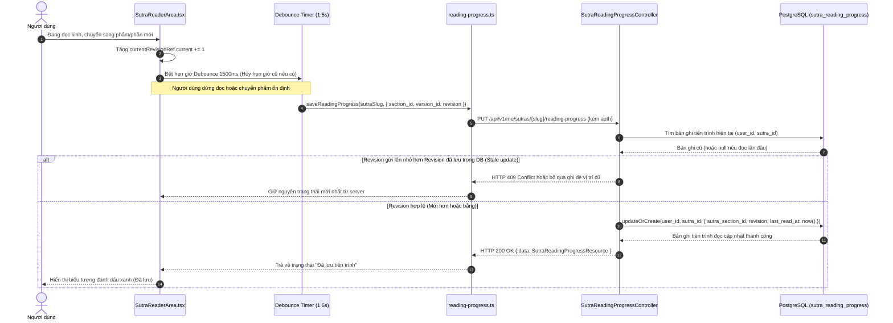

# SƠ ĐỒ TUẦN TỰ: TỰ ĐỘNG LƯU TIẾN TRÌNH ĐỌC KINH (M02.06)

---

### Thuyết minh nghiệp vụ

**Tên chức năng:** Tự động lưu tiến trình đọc kinh (Reading Progress Auto-Save).

**Mã chức năng:** M02.06

**Mục đích:** Ghi nhớ vị trí phẩm kinh mà Phật tử đang đọc dở để khi mở lại kinh hoặc vào Tủ kinh cá nhân có thể tiếp tục hành trì ngay lập tức.

**Tác nhân:** Người dùng đã đăng nhập.

**Điều kiện tiên quyết:** Người dùng có tài khoản và đang đọc một phẩm kinh cụ thể.

**Luồng xử lý chính:**
1. Khi người dùng chuyển phẩm hoặc cuộn đọc, `SutraReaderArea.tsx` kích hoạt hàm theo dõi.
2. Quản lý `currentRevisionRef` tăng dần theo từng lần tương tác để kiểm soát thứ tự phiên.
3. Kích hoạt cơ chế Debounce 1.5 giây để tránh gửi dồn dập request lên máy chủ khi người dùng lướt nhanh mục lục.
4. Hết thời gian debounce, gọi `saveReadingProgress()` gửi `PUT /api/v1/me/sutras/{slug}/reading-progress`.
5. `SutraReadingProgressController::upsert` kiểm tra khóa lạc quan (Optimistic Concurrency Control) dựa vào `revision` để đảm bảo nếu người dùng mở nhiều tab, tab đọc sau không bị tab đọc trước ghi đè lùi vị trí.
6. Cập nhật `sutra_section_id`, `last_read_at = now()`, `revision` vào bảng `sutra_reading_progress`.
7. Trả về mã HTTP 200 và giao diện hiển thị thông báo tiến trình đã được đồng bộ.

**Luồng ngoại lệ:**
- Nếu chưa đăng nhập: Trả về 401 Unauthorized, client im lặng bỏ qua việc lưu lên server mà không làm gián đoạn việc đọc của độc giả.

**Kết quả:** Vị trí đọc kinh được lưu trữ bền vững trong cơ sở dữ liệu.

**Các file source code liên quan:**
- Frontend: `src/components/sutra/SutraReaderArea.tsx` (dòng 40-80), `src/lib/api/reading-progress.ts`.
- Backend: `app/Http/Controllers/Api/V1/SutraReadingProgressController.php` (hàm `upsert`), `app/Models/SutraReadingProgress.php`.
