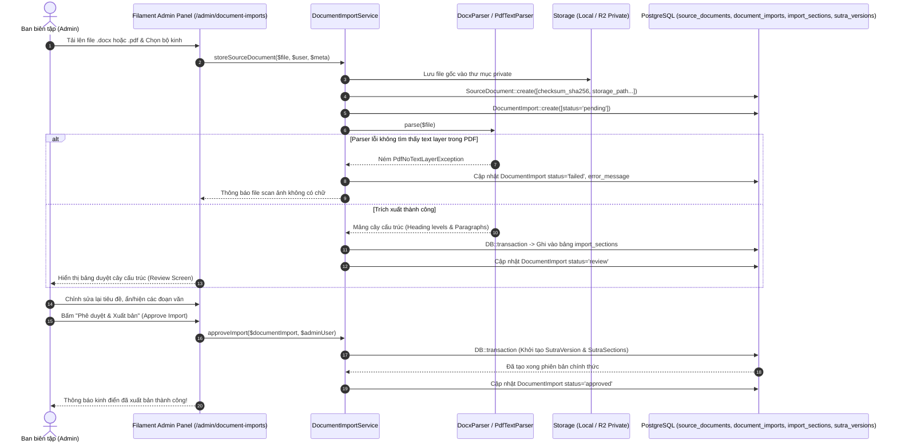

# SƠ ĐỒ TUẦN TỰ: NHẬP LIỆU & SỐ HÓA KINH ĐIỂN TỪ WORD/PDF (M03.01, M03.02, M03.03)

---

### Thuyết minh nghiệp vụ

**Tên chức năng:** Nhập liệu và số hóa kinh điển tự động từ tài liệu DOCX/PDF.

**Mã chức năng:** M03.01, M03.02, M03.03

**Mục đích:** Hỗ trợ ban biên tập chuyển đổi nhanh các tệp bản dịch kinh Word (.docx) hoặc PDF dạng chữ (.pdf) thành cấu trúc cây phẩm kinh và nội dung hiển thị trên web mà không cần nhập liệu thủ công từng trang.

**Tác nhân:** Quản trị viên / Ban biên tập có quyền truy cập Filament Admin.

**Điều kiện tiên quyết:** Đã đăng nhập vào Admin Panel với `role = 'admin'`.

**Luồng xử lý chính:**
1. Quản trị viên tải file lên tại màn hình `DocumentImports` trong Filament.
2. `DocumentImportService::storeSourceDocument` kiểm tra dung lượng (tối đa 20MB), tính toán checksum SHA-256 để chống trùng file, lưu vào disk bảo mật.
3. Tùy thuộc định dạng file, dịch vụ điều hướng đến `DocxParser` hoặc `PdfTextParser` (sử dụng thư viện `smalot/pdfparser`).
4. Bộ phân tích cú pháp trích xuất các tiêu đề Heading 1, 2, 3 và các đoạn văn bản kèm số trang nguồn (`source_page_start`, `source_page_end`).
5. Toàn bộ cây nội dung được ghi vào bảng `import_sections` với trạng thái `status = 'review'`.
6. Ban biên tập có thể xem trước, hiệu đính câu chữ, bật/tắt cờ `is_included` trực tiếp trên Filament.
7. Khi bấm "Approve", `DocumentImportService::approveImport` thực thi một `DB::transaction` biến đổi các `import_sections` thành `sutra_versions` và `sutra_sections` chính thức, sẵn sàng cho độc giả đọc.

**Luồng ngoại lệ:**
- Nếu file PDF là ảnh quét scan không có lớp text (Text Layer), hệ thống ném ngoại lệ `PdfNoTextLayerException` và hiển thị cảnh báo cho biên tập viên.

**Kết quả:** Bộ kinh được số hóa hoàn chỉnh với cây mục lục chuẩn mực trên cơ sở dữ liệu.

**Các file source code liên quan:**
- Backend: `app/Services/Documents/DocumentImportService.php`, `app/Services/Documents/DocxParser.php`, `app/Services/Documents/PdfTextParser.php`, `app/Filament/Resources/DocumentImports/DocumentImportResource.php`.
- Database: `source_documents`, `document_imports`, `import_sections`, `sutra_versions`, `sutra_sections`.
