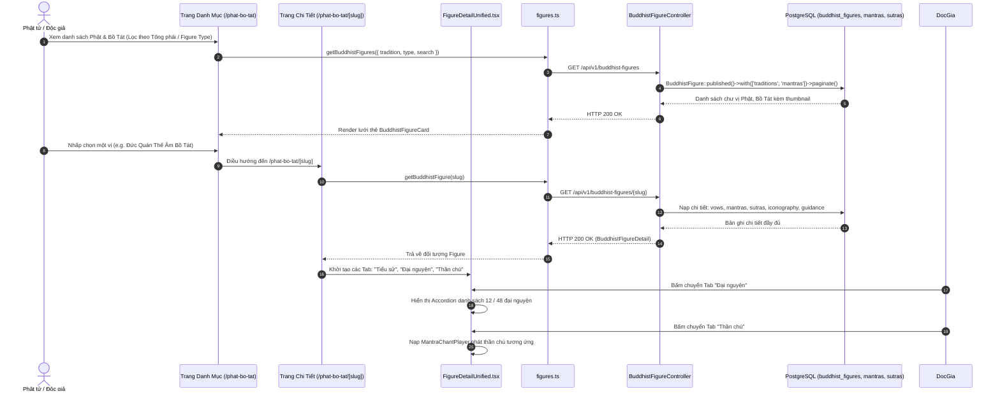

# SƠ ĐỒ TUẦN TỰ: TRA CỨU DANH TỬ CHƯ PHẬT & BỒ TÁT (M04.01, M04.02)

---

### Thuyết minh nghiệp vụ

**Tên chức năng:** Tra cứu danh tự, tiểu sử và đại nguyện Chư Phật & Bồ Tát.

**Mã chức năng:** M04.01, M04.02, M04.03

**Mục đích:** Cung cấp thông tin giáo lý chính thống về các vị Phật, Đại Bồ Tát trong các truyền thống (Bắc tông, Nam tông, Kim Cương thừa), làm nơi quy hướng tâm linh và hỗ trợ tu học.

**Tác nhân:** Khách truy cập hoặc Thành viên.

**Điều kiện tiên quyết:** Vị Phật/Bồ Tát đã được kiểm duyệt và xuất bản (`status = 'published'`).

**Luồng xử lý chính:**
1. Người dùng mở `/phat-bo-tat`, hệ thống gọi `GET /api/v1/buddhist-figures` để lấy danh sách phân trang kèm bộ lọc theo tông phái.
2. Khi người dùng bấm vào một vị, chuyển hướng đến `/phat-bo-tat/[slug]`.
3. Frontend gọi `GET /api/v1/buddhist-figures/{slug}`.
4. `BuddhistFigureController::show` tải toàn bộ dữ liệu gồm: tiểu sử, hình tượng, hướng dẫn hành trì, danh sách đại nguyện (`vows`), và các thần chú liên kết (`mantras`).
5. Giao diện `FigureDetailUnified.tsx` tổ chức nội dung thành 3 tab: Tiểu sử, Đại nguyện (hiển thị dạng Accordion) và Thần chú (tích hợp trình phát âm thanh trì niệm).

**Luồng ngoại lệ:**
- Nếu slug không tồn tại hoặc chưa xuất bản: Trả về lỗi 404 Không tìm thấy nội dung.

**Kết quả:** Toàn bộ giáo lý, hình tượng và thần chú của vị Phật/Bồ Tát được hiển thị trang nghiêm.

**Các file source code liên quan:**
- Frontend: `src/app/phat-bo-tat/page.tsx`, `src/app/phat-bo-tat/[slug]/page.tsx`, `src/components/figure/FigureDetailUnified.tsx`, `src/lib/api/figures.ts`.
- Backend: `app/Http/Controllers/Api/V1/BuddhistFigureController.php`, `app/Models/BuddhistFigure.php`.
