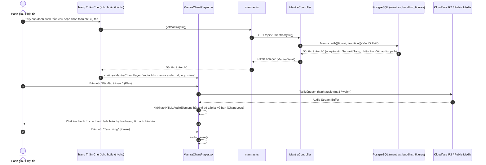

# SƠ ĐỒ TUẦN TỰ: TRA CỨU & TRÌ NIỆM THẦN CHÚ (M05.01, M05.02, M05.03)

---

### Thuyết minh nghiệp vụ

**Tên chức năng:** Tra cứu ý nghĩa và trì tụng thần chú lặp lại (Mantra Chanting).

**Mã chức năng:** M05.01, M05.02, M05.03

**Mục đích:** Hỗ trợ hành giả học thuộc chân ngôn, phát âm đúng ngữ điệu phiên âm tiếng Việt và trì tụng theo nhịp điệu thanh tịnh với âm thanh thu âm chuẩn mực.

**Tác nhân:** Phật tử hoặc người thực hành tu tập.

**Điều kiện tiên quyết:** Thần chú đã xuất bản và có file âm thanh (`audio_path`).

**Luồng xử lý chính:**
1. Hành giả mở trang thần chú tại `/chu/[slug]` hoặc từ phân hệ `/tri-chu`.
2. Frontend gọi `GET /api/v1/mantras/{slug}`.
3. `MantraController::show` trả về nguyên văn, phiên âm tiếng Việt, ý nghĩa, hướng dẫn hành trì và URL tệp âm thanh (`audio_url`).
4. `MantraChantPlayer.tsx` khởi tạo trình phát âm thanh với chế độ lặp lại vô hạn (`loop = true`) – tính chất đặc thù của trì chú.
5. Khi người dùng bấm Play, trình duyệt kết nối đến Cloudflare R2 (`media.ompramani.vn`) hoặc bộ nhớ tĩnh tải tệp âm thanh và phát liên tục theo chu kỳ.
6. Hỗ trợ hiển thị thanh thời gian, điều chỉnh âm lượng và dừng phát khi hoàn tất thời khóa.

**Luồng ngoại lệ:**
- Nếu file âm thanh bị lỗi hoặc chưa cập nhật: Trình phát hiển thị trạng thái cảnh báo và chuyển sang chế độ tụng thầm theo bản phiên âm văn bản.

**Kết quả:** Hành giả lắng nghe và trì tụng thần chú theo nhịp điệu trang nghiêm.

**Các file source code liên quan:**
- Frontend: `src/app/chu/[slug]/page.tsx`, `src/app/tri-chu/page.tsx`, `src/components/mantra/MantraChantPlayer.tsx`, `src/lib/api/mantras.ts`.
- Backend: `app/Http/Controllers/Api/V1/MantraController.php`, `app/Models/Mantra.php`.
