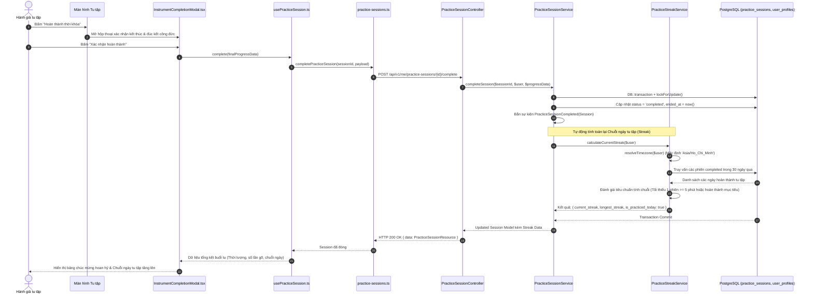

# SƠ ĐỒ TUẦN TỰ: HOÀN THÀNH PHIÊN TU TẬP & CẬP NHẬT CHUỖI STREAK (M06.07, M10.04)

---

### Thuyết minh nghiệp vụ

**Tên chức năng:** Hoàn thành phiên tu tập và tính toán chuỗi ngày tu tập (Streak).

**Mã chức năng:** M06.07, M10.04

**Mục đích:** Đóng phiên tu tập, ghi nhận thành tựu công phu và tính toán số ngày tu tập liên tục (Streak) theo múi giờ của người dùng để khích lệ tinh thần tinh tấn.

**Tác nhân:** Hành giả đang có phiên tu tập đang mở.

**Điều kiện tiên quyết:** Phiên tu tập đang ở trạng thái `active` hoặc `paused`.

**Luồng xử lý chính:**
1. Hành giả bấm hoàn thành trên thanh công cụ thời khóa, hộp thoại `InstrumentCompletionModal.tsx` mở ra.
2. Xác nhận gửi request `POST /api/v1/me/practice-sessions/{id}/complete`.
3. `PracticeSessionService::completeSession` chạy trong `DB::transaction` với `lockForUpdate()`.
4. Ghi nhận thời điểm kết thúc `ended_at = now()`, trạng thái `completed`, lưu lần cuối dữ liệu `progress_data`.
5. Bắn sự kiện nội bộ `PracticeSessionCompleted`.
6. Gọi `PracticeStreakService::calculateCurrentStreak` để tính toán chuỗi ngày:
   - Xác định múi giờ người dùng từ `user_profiles.timezone` (nếu không có thì dùng `Asia/Ho_Chi_Minh`).
   - Kiểm tra chính sách đủ điều kiện (`PracticeStreakEligibilityPolicy`): thời gian hành trì tối thiểu đạt yêu cầu.
   - Quét ngược từ ngày hôm nay về quá khứ để xác định số ngày liên tiếp có thực hành tu tập.
7. Trả về kết quả phiên và thông tin chuỗi ngày mới.
8. Giao diện hiển thị bảng đúc kết thời khóa tu học trang nghiêm.

**Luồng ngoại lệ:**
- Phiên đã bị hủy hoặc hoàn thành trước đó: Trả về lỗi 422, đóng phiên trên giao diện.

**Kết quả:** Phiên tu tập chuyển trạng thái `completed`, chuỗi tu tập (`current_streak`) được cập nhật trên dashboard Hành trình tu học.

**Các file source code liên quan:**
- Frontend: `src/components/instruments/InstrumentCompletionModal.tsx`, `src/hooks/usePracticeSession.ts`, `src/lib/api/practice-sessions.ts`.
- Backend: `app/Services/Practice/PracticeSessionService.php` (hàm `completeSession`), `app/Services/Practice/PracticeStreakService.php`, `app/Services/Practice/PracticeStreakEligibilityPolicy.php`, `app/Http/Controllers/Api/V1/PracticeSessionController.php`.
