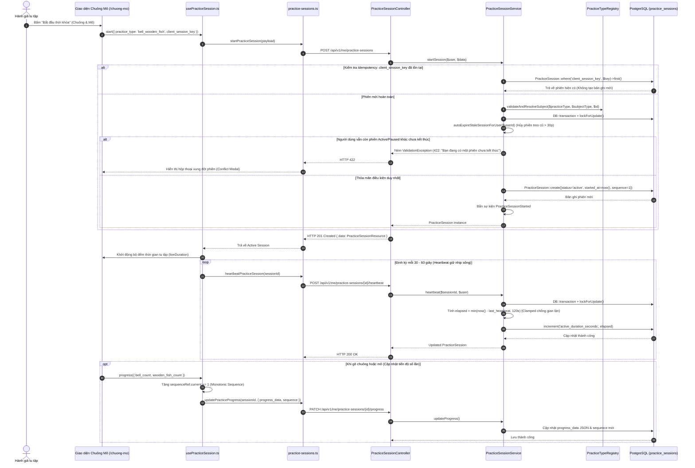

# SƠ ĐỒ TUẦN TỰ: KHỞI TẠO VÀ HEARTBEAT PHIÊN TU TẬP (M06.01, M06.05, M06.06)

---

### Thuyết minh nghiệp vụ

**Tên chức năng:** Khởi tạo, gửi nhịp tim (Heartbeat) và cập nhật tiến độ phiên tu tập.

**Mã chức năng:** M06.01, M06.05, M06.06

**Mục đích:** Ghi nhận chính xác, khách quan thời lượng hành trì của hành giả; chống gian lận thời gian; ngăn chặn tình trạng mở đồng thời nhiều phiên gây sai lệch dữ liệu công phu.

**Tác nhân:** Người dùng đã đăng nhập (Hành giả).

**Điều kiện tiên quyết:** Người dùng có tài khoản hợp lệ.

**Luồng xử lý chính:**
1. Hành giả bấm "Bắt đầu thời khóa", `usePracticeSession.ts` sinh mã duy nhất `client_session_key` gửi `POST /api/v1/me/practice-sessions`.
2. `PracticeSessionService::startSession` kiểm tra idempotency để tránh việc bấm đúp tạo 2 phiên trùng nhau.
3. Chạy `DB::transaction()` và khóa dòng bi quan `lockForUpdate()`.
4. Tự động kiểm tra và đánh dấu hết hạn (`expired`) các phiên cũ bị bỏ quên quá 30 phút không có heartbeat.
5. Kiểm tra tính toàn vẹn: mỗi hành giả chỉ được phép có duy nhất **một phiên đang mở** (`Active` hoặc `Paused`) tại một thời điểm.
6. Tạo bản ghi `practice_sessions` với trạng thái `active`, phát sự kiện `PracticeSessionStarted`.
7. Trong suốt buổi tu, Frontend tự động gửi nhịp tim `POST /heartbeat` mỗi 30-60 giây.
8. Server tính toán khoảng thời gian trôi qua và kẹp ngưỡng trần tối đa **120 giây** (`MAX_HEARTBEAT_ELAPSED_SECONDS`). Nếu máy khách tắt mạng 2 tiếng rồi gửi heartbeat, server cũng chỉ cộng tối đa 120 giây, ngăn chặn tuyệt đối việc hack thời gian tu tập.
9. Khi gõ chuông hoặc mõ, số đếm được gửi qua `PATCH /progress` kèm số thứ tự đơn điệu (`sequence`) để đảm bảo các gói tin đến chậm không ghi đè dữ liệu mới hơn.

**Luồng ngoại lệ:**
- Nếu đang có phiên mở trên thiết bị khác: Server ném lỗi 422, Frontend bật `MeditationConflictModal` cho phép người dùng lựa chọn hủy phiên cũ hoặc tiếp tục phiên đang dang dở.

**Kết quả:** Phiên tu tập được ghi nhận trực tiếp, thời gian tu tập được cộng dồn chính xác đến từng giây.

**Các file source code liên quan:**
- Frontend: `src/hooks/usePracticeSession.ts`, `src/lib/api/practice-sessions.ts`, `src/app/chuong-mo/InstrumentsClient.tsx`.
- Backend: `app/Services/Practice/PracticeSessionService.php` (các hàm `startSession`, `heartbeat`, `updateProgress`), `app/Http/Controllers/Api/V1/PracticeSessionController.php`, `app/Models/PracticeSession.php`.
