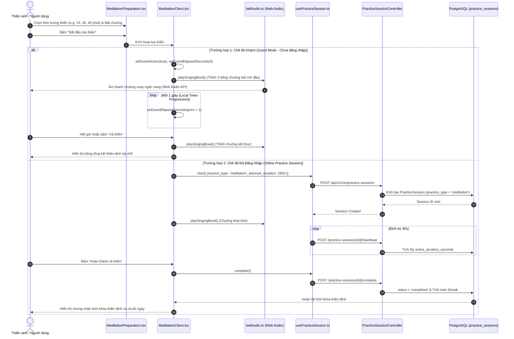

# SƠ ĐỒ TUẦN TỰ: THỰC HÀNH THIỀN ĐỊNH ONLINE & GUEST MODE (M07.01, M07.02, M07.03)

---

### Thuyết minh nghiệp vụ

**Tên chức năng:** Thực hành thiền định (Meditation Session) hỗ trợ chế độ Khách và Tài khoản.

**Mã chức năng:** M07.01, M07.02, M07.03

**Mục đích:** Cung cấp không gian tọa thiền tĩnh lặng với âm thanh chuông xoay Tây Tạng (Tibetan singing bowl) được mô phỏng chân thực bằng Web Audio API, đồng thời lưu trữ lịch sử thiền vào hồ sơ cá nhân.

**Tác nhân:** Bất kỳ ai muốn thực hành thiền định (Khách vãng lai hoặc Thành viên).

**Điều kiện tiên quyết:** Thiết bị hỗ trợ trình duyệt web và âm thanh.

**Luồng xử lý chính:**
1. Thiền sinh truy cập `/thien`, chọn thời gian tọa thiền (15 phút, 30 phút, 45 phút hoặc tùy chỉnh).
2. Khi bấm bắt đầu:
   - **Nếu là Khách (Chưa đăng nhập):** Hệ thống chạy bộ đếm thời gian hoàn toàn phía Client (`guestElapsedSeconds`), không đòi hỏi đăng nhập hay kết nối mạng, phát chuông bát bằng Web Audio API.
   - **Nếu đã đăng nhập:** Hệ thống kích hoạt hook `usePracticeSession.ts` gửi yêu cầu lên server khởi tạo phiên `meditation`, định kỳ gửi heartbeat tích lũy phút thiền định.
3. Khi hết thời gian hoặc bấm xả thiền, chuông kết thúc vang lên và hệ thống tổng kết thời lượng tọa thiền.

**Luồng ngoại lệ:**
- Nếu đang có phiên thiền định hoặc chuông mõ khác chưa đóng: Hệ thống hiển thị `MeditationConflictModal` để thiền sinh quyết định xử lý phiên cũ trước khi vào thiền mới.

**Kết quả:** Thời khóa thiền định được hoàn thành thanh tịnh, số phút thiền được ghi nhận vào Hành trình tu học nếu có tài khoản.

**Các file source code liên quan:**
- Frontend: `src/app/thien/page.tsx`, `src/app/thien/MeditationClient.tsx`, `src/components/meditation/MeditationPreparation.tsx`, `src/components/meditation/MeditationActiveSession.tsx`, `src/lib/utils/bellAudio.ts`.
- Backend: Sử dụng chung hạ tầng API `PracticeSessionService` với `practice_type = 'meditation'`.
