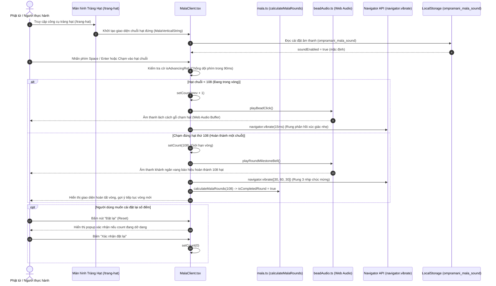

# SƠ ĐỒ TUẦN TỰ: LẦN TRÀNG HẠT ĐIỆN TỬ PHÍA CLIENT (M08.01, M08.02)

---

### Thuyết minh nghiệp vụ

**Tên chức năng:** Lần tràng hạt 108 hạt điện tử (Virtual Mala Beads).

**Mã chức năng:** M08.01, M08.02

**Mục đích:** Cung cấp phương tiện trợ niệm lần chuỗi hạt số hóa cho Phật tử niệm Phật, trì chú mọi lúc mọi nơi mà không cần mang theo tràng hạt vật lý; hoạt động độc lập ngay cả khi không có kết nối Internet.

**Tác nhân:** Phật tử hoặc người thực hành niệm Phật.

**Điều kiện tiên quyết:** Thiết bị hỗ trợ trình duyệt web.

**Đặc điểm triển khai thực tế (Quan trọng):**
- **Hoàn toàn phía Client (Client-Side Only):** Qua kiểm tra mã nguồn, chức năng này **không gọi bất kỳ API nào và không lưu vào database**. Mọi thao tác đếm hạt, tính toán vòng hạt và hiệu ứng âm thanh/rung xúc giác đều chạy cục bộ trên trình duyệt.

**Luồng xử lý chính:**
1. Phật tử mở trang `/trang-hat`.
2. Hệ thống tải trạng thái âm thanh từ `localStorage` (`ompramani_mala_sound`).
3. Phật tử có thể gõ phím **Space**, **Enter** hoặc chạm trực tiếp vào hạt chuỗi trên màn hình cảm ứng để lần từng hạt.
4. Có cơ chế chống dội phím (`isAdvancingRef`, debounce 90ms) để không bị nhảy hạt khi nhấn giữ phím.
5. Mỗi hạt trôi qua, trình duyệt phát tiếng lách cách hạt gỗ (`playBeadClick()`) và rung nhẹ thiết bị cầm tay (`navigator.vibrate(15)`).
6. Khi đạt đủ **108 hạt**, âm thanh chuông khánh ngân vang (`playRoundMilestoneBell()`) và máy rung 3 nhịp chúc mừng hoàn mãn một vòng chuỗi niệm.

**Luồng ngoại lệ:**
- Nếu thiết bị không hỗ trợ rung (`navigator.vibrate` không tồn tại), hệ thống tự động bắt lỗi và bỏ qua mà không làm gián đoạn việc đếm.

**Kết quả:** Phật tử giữ được chánh niệm và số lượng biến niệm Phật/trì chú qua từng hạt chuỗi.

**Các file source code liên quan:**
- Frontend: `src/app/trang-hat/page.tsx`, `src/app/trang-hat/MalaClient.tsx`, `src/components/mala/MalaVerticalString.tsx`, `src/lib/practice/mala.ts`, `src/lib/utils/beadAudio.ts`.
