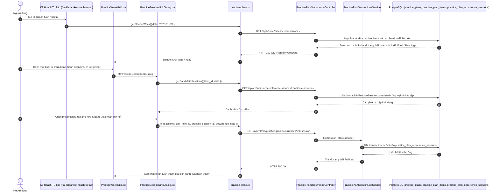

# SƠ ĐỒ TUẦN TỰ: KẾ HOẠCH TU TẬP & LIÊN KẾT PHIÊN THỰC TẾ (M09.05, M09.07, M09.08)

---

### Thuyết minh nghiệp vụ

**Tên chức năng:** Lập kế hoạch tu tập tuần và liên kết phiên hành trì thực tế.

**Mã chức năng:** M09.05, M09.07, M09.08

**Mục đích:** Giúp người tu học đặt ra mục tiêu tu tập trong tuần và đối chiếu xem buổi thực hành thực tế có hoàn thành đúng thời khóa đã đề ra hay không.

**Tác nhân:** Người dùng đã đăng nhập.

**Điều kiện tiên quyết:** Người dùng đã tạo kế hoạch tu tập và có phiên tu tập hoàn thành.

**Luồng xử lý chính:**
1. Người dùng mở trang `/tai-khoan/ke-hoach-tu-tap`.
2. Hệ thống gọi `GET /api/v1/me/practice-planner/week` tải lịch tuần với từng buổi tu theo các trạng thái: `pending` (chưa tu), `fulfilled` (đã tu), `skipped` (bỏ qua).
3. Nếu người dùng tu tự do bên ngoài (ví dụ vào `/chuong-mo` gõ mõ xong), có thể bấm vào buổi tu trên kế hoạch để liên kết phiên đó vào lịch.
4. `PracticeSessionLinkDialog.tsx` gọi `getCandidateSessions` để lấy các phiên tu tập phù hợp về mặt pháp môn (`practice_type`) và thời gian.
5. Khi người dùng xác nhận, `PracticePlanSessionLinkService` lưu liên kết vào bảng `practice_plan_occurrence_sessions`.
6. Lưới thời khóa tuần chuyển sang màu xanh đánh dấu đã hoàn thành mục tiêu.

**Luồng ngoại lệ:**
- Phiên tu tập đã bị hủy hoặc không cùng loại hình: Hệ thống từ chối liên kết và báo lỗi 422.

**Kết quả:** Buổi tu trong kế hoạch được đối soát và ghi nhận hoàn thành.

**Các file source code liên quan:**
- Frontend: `src/components/practice-planner/PracticePlannerManager.tsx`, `src/components/practice-planner/PracticeWeekGrid.tsx`, `src/components/practice-planner/PracticeSessionLinkDialog.tsx`.
- Backend: `app/Http/Controllers/Api/V1/PracticePlanOccurrenceController.php`, `app/Services/Practice/PracticePlanSessionLinkService.php`, `app/Models/PracticePlan.php`.
