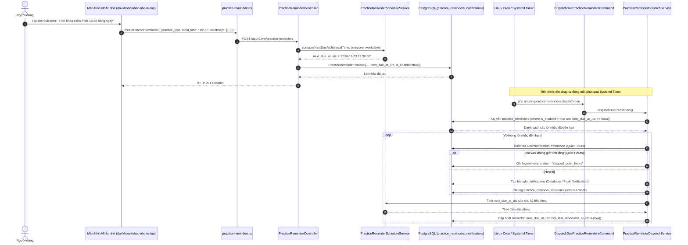

# SƠ ĐỒ TUẦN TỰ: LẬP LỊCH NHẮC NHỞ & PHÂN PHÁT TỰ ĐỘNG (M09.01, M09.03, M09.04)

---

### Thuyết minh nghiệp vụ

**Tên chức năng:** Lập lịch nhắc nhở tu tập và phân phát tự động qua tiến trình nền.

**Mã chức năng:** M09.01, M09.03, M09.04

**Mục đích:** Giúp Phật tử duy trì công phu đều đặn bằng cách nhắc nhở đúng giờ; hệ thống nền quét định kỳ để gửi thông báo mà không làm chậm trải nghiệm người dùng.

**Tác nhân:** Người dùng (Lập lịch) và Hệ thống tự động (Cron Scheduler phân phát).

**Điều kiện tiên quyết:** Người dùng kích hoạt lời nhắc và cấu hình múi giờ phù hợp.

**Luồng xử lý chính:**
1. Người dùng cài đặt giờ nhắc nhở (ví dụ 19:30) và các ngày trong tuần tại `/tai-khoan/nhac-nho-tu-tap`.
2. `PracticeReminderScheduleService` quy đổi giờ địa phương (`local_time`) và múi giờ (`timezone`) của người dùng sang giờ UTC chuẩn (`next_due_at_utc`).
3. Lưu vào cơ sở dữ liệu với trạng thái `is_enabled = true`.
4. Trên máy chủ, Systemd Timer kích hoạt lệnh `practice-reminders:dispatch-due` mỗi 1 phút một lần theo cấu hình tại [routes/console.php](file:///f:/Ompramani/ompramani-api/routes/console.php).
5. `PracticeReminderDispatchService` truy vấn các lời nhắc có `next_due_at_utc <= now()`.
6. Kiểm tra cài đặt Giờ tĩnh lặng (`Quiet Hours`): Nếu người dùng đang trong thời gian nghỉ ngơi, hệ thống ghi nhận trạng thái bỏ qua `skipped_quiet_hours`.
7. Nếu hợp lệ, bắn thông báo `PrayerCommunityNotification` vào bảng `notifications`.
8. Tính toán lại thời điểm nhắc tiếp theo và cập nhật vào database.

**Luồng ngoại lệ:**
- Lời nhắc bị trễ quá 60 phút do máy chủ khởi động lại: Hệ thống ghi log `skipped_late` và nhảy thẳng đến chu kỳ tiếp theo để tránh làm phiền người dùng.

**Kết quả:** Lời nhắc được gửi đúng giờ, lịch trình tiếp theo được tự động gia hạn.

**Các file source code liên quan:**
- Backend: `routes/console.php`, `app/Console/Commands/DispatchDuePracticeRemindersCommand.php`, `app/Services/Practice/PracticeReminderDispatchService.php`, `app/Services/Practice/PracticeReminderScheduleService.php`, `app/Models/PracticeReminder.php`, `app/Models/PracticeReminderDelivery.php`.
