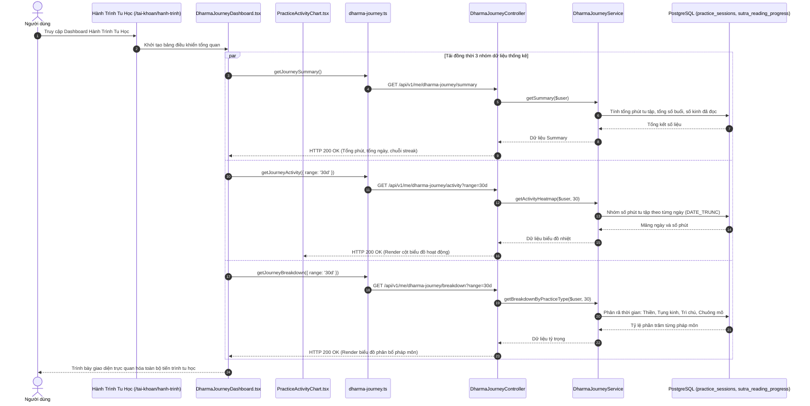

# SƠ ĐỒ TUẦN TỰ: HÀNH TRÌNH TU HỌC & THỐNG KÊ TIẾN ĐỘ (M10.01, M10.02, M10.03)

---

### Thuyết minh nghiệp vụ

**Tên chức năng:** Theo dõi tổng quan hành trình tu học cá nhân (Dharma Journey Dashboard).

**Mã chức năng:** M10.01, M10.02, M10.03

**Mục đích:** Cung cấp cho Phật tử cái nhìn toàn cảnh về công phu tu tập cá nhân qua các con số thống kê chính xác, biểu đồ thời gian và sự cân bằng giữa các pháp môn.

**Tác nhân:** Người dùng đã đăng nhập.

**Điều kiện tiên quyết:** Người dùng có tài khoản trên hệ thống.

**Luồng xử lý chính:**
1. Khi mở `/tai-khoan/hanh-trinh`, trang web gửi song song 3 truy vấn API để tối ưu tốc độ tải:
   - `GET /summary`: Thống kê tổng số phút tu tập, số buổi hoàn thành, số kinh điển đã đọc và chuỗi ngày liên tục.
   - `GET /activity`: Trả về dữ liệu chuỗi thời gian (Time-series) trong 7 ngày, 30 ngày hoặc 90 ngày để vẽ biểu đồ cột/biểu đồ nhiệt.
   - `GET /breakdown`: Tổng hợp tỷ lệ thời gian phân bổ giữa các pháp môn: Thiền định (`meditation`), Tụng kinh (`sutra`), Trì chú (`mantra`), Chuông mõ (`bell_wooden_fish`).
2. `DharmaJourneyService` thực hiện các truy vấn gộp (Aggregate Query) và nhóm theo ngày theo múi giờ cá nhân của người dùng.
3. Giao diện Next.js hiển thị các thẻ tóm tắt (`JourneySummaryCards.tsx`), biểu đồ hoạt động (`PracticeActivityChart.tsx`) và biểu đồ tỷ trọng pháp môn (`PracticeTypeBreakdown.tsx`).

**Luồng ngoại lệ:**
- Người dùng mới chưa có buổi tu nào: Hệ thống trả về số liệu 0 kèm lời khuyên khởi đầu thời khóa đầu tiên.

**Kết quả:** Toàn bộ công đức và thời gian tu học được tổng kết minh bạch, khoa học.

**Các file source code liên quan:**
- Frontend: `src/app/tai-khoan/hanh-trinh/page.tsx`, `src/components/dharma-journey/DharmaJourneyDashboard.tsx`, `src/lib/api/dharma-journey.ts`.
- Backend: `app/Http/Controllers/Api/V1/DharmaJourneyController.php`, `app/Services/DharmaJourney/DharmaJourneyService.php`.
