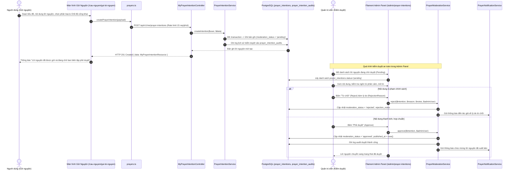

# SƠ ĐỒ TUẦN TỰ: GỬI LỜI CẦU NGUYỆN & QUY TRÌNH KIỂM DUYỆT (M11.02, M11.04, M11.08)

---

### Thuyết minh nghiệp vụ

**Tên chức năng:** Gửi lời cầu nguyện cá nhân và quy trình kiểm duyệt an toàn nội dung.

**Mã chức năng:** M11.02, M11.04, M11.08

**Mục đích:** Đảm bảo không gian cầu nguyện cộng đồng luôn trang nghiêm, đúng chánh pháp, ngăn chặn các hành vi trục lợi tâm linh, mê tín dị đoan hoặc ngôn từ thù ghét.

**Tác nhân:** Người dùng (Tạo lời nguyện) và Quản trị viên (Kiểm duyệt).

**Điều kiện tiên quyết:** Người dùng đã đăng nhập; Quản trị viên có quyền truy cập Filament Admin.

**Luồng xử lý chính:**
1. Người dùng soạn lời nguyện (cầu an, cầu siêu, hồi hướng, sám hối...) tại `/cau-nguyen/gui-loi-nguyen`.
2. Frontend gọi `POST /api/v1/me/prayer-intentions`.
3. `PrayerIntentionService::createIntention` ghi nhận lời nguyện vào bảng `prayer_intentions` với trạng thái ban đầu bắt buộc là `pending` (chờ duyệt).
4. Đồng thời ghi log vết kiểm duyệt đầu tiên vào bảng `prayer_intention_audits`.
5. Ban biên tập kiểm tra nội dung trong Filament Admin.
6. Khi duyệt:
   - **Nếu Hợp lệ:** Đánh dấu `moderation_status = 'approved'`, cập nhật `published_at = now()`, phát thông báo đến chuông thông báo của tác giả.
   - **Nếu Vi phạm:** Chọn lý do từ chối từ Enum `PrayerRejectionReason` (mê tín, thông tin cá nhân nhạy cảm, quảng cáo...), cập nhật trạng thái `rejected`.
7. Lời nguyện chỉ hiển thị ra bảng tin cộng đồng công khai sau khi đã được phê duyệt.

**Luồng ngoại lệ:**
- Người dùng gửi quá 15 lời nguyện trong 1 phút: Bị chặn bởi Middleware Throttle (mã lỗi 429).

**Kết quả:** Lời nguyện được quản lý vòng đời chặt chẽ, an toàn về mặt truyền thông Phật giáo.

**Các file source code liên quan:**
- Frontend: `src/app/cau-nguyen/gui-loi-nguyen/page.tsx`, `src/components/prayer/SubmitPrayerForm.tsx`, `src/lib/api/prayers.ts`.
- Backend: `app/Http/Controllers/Api/V1/MyPrayerIntentionController.php`, `app/Services/Prayer/PrayerIntentionService.php`, `app/Services/Prayer/PrayerModerationService.php`, `app/Filament/Resources/PrayerIntentions/PrayerIntentionResource.php`.
