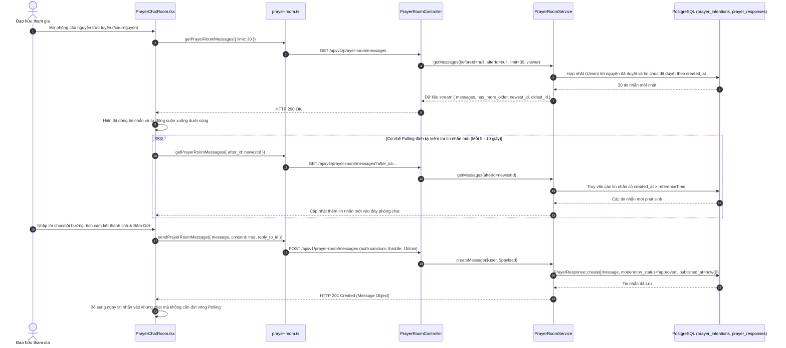

# SƠ ĐỒ TUẦN TỰ: PHÒNG CẦU NGUYỆN TRỰC TUYẾN & POLLING TIN NHẮN (M11.06, M11.07)

---

### Thuyết minh nghiệp vụ

**Tên chức năng:** Phòng cầu nguyện tâm linh chung và cơ chế Polling tin nhắn (Unified Prayer Room).

**Mã chức năng:** M11.06, M11.07

**Mục đích:** Tạo không gian đạo tràng trực tuyến nơi cộng đồng Phật tử cùng nhau hướng tâm, đọc các lời nguyện tha thiết và gửi lời động viên, hồi hướng công đức cho nhau.

**Tác nhân:** Thành viên đã đăng nhập (gửi tin) hoặc Khách vãng lai (xem tin).

**Điều kiện tiên quyết:** Người gửi tin đã đăng nhập và đồng ý với quy chuẩn sinh hoạt thanh tịnh (`consentChecked`).

**Đặc điểm kiến trúc thực tế (Quan trọng):**
- **Kiến trúc Polling:** Source code sử dụng cơ chế kéo tin nhắn theo con trỏ (`after_id` để lấy tin nhắn mới hơn, `before_id` để tải lịch sử cũ hơn) thay vì kiến trúc WebSocket hai chiều, giúp giảm thiểu tải hạ tầng máy chủ và tương thích tốt với môi trường serverless/container.
- **Hợp nhất dữ liệu (Unified Stream):** `PrayerRoomService` tự động hợp nhất cả hai nguồn dữ liệu: lời nguyện cộng đồng (`PrayerIntention`) và các lời hồi hướng chia sẻ (`PrayerResponse`) thành một dòng hội thoại thời gian duy nhất.

**Luồng xử lý chính:**
1. Khi vào phòng, `PrayerChatRoom.tsx` nạp 30 tin nhắn gần nhất qua `GET /api/v1/prayer-room/messages`.
2. Trình duyệt thiết lập vòng lặp Polling gửi `after_id` của tin nhắn mới nhất để nhận các tin nhắn vừa được duyệt hoặc vừa được gửi.
3. Người dùng nhập lời chúc/cầu nguyện, bắt buộc tích chọn cam kết không phát ngôn sai chuẩn mực rồi bấm "Gửi".
4. `PrayerRoomController::store` lưu bản ghi vào database.
5. Giao diện cập nhật ngay tin nhắn vừa gửi (Optimistic UI update) và cuộn mượt xuống đáy màn hình.

**Luồng ngoại lệ:**
- Nếu phát hiện tin nhắn có dấu hiệu lừa đảo, xin tiền hoặc xúc phạm: Người dùng có thể bấm biểu tượng báo cáo vi phạm (`reportPrayerRoomMessage`), hệ thống ghi nhận vào bảng `prayer_response_reports` để ban quản trị xử lý xóa bỏ ngay lập tức.

**Kết quả:** Phòng giao lưu tâm linh hoạt động thông suốt, an toàn và có tính gắn kết cộng đồng cao.

**Các file source code liên quan:**
- Frontend: `src/components/prayer/PrayerChatRoom.tsx` (dòng 1-150), `src/lib/api/prayer-room.ts`.
- Backend: `app/Http/Controllers/Api/V1/PrayerRoomController.php`, `app/Services/Prayer/PrayerRoomService.php`, `app/Models/PrayerResponse.php`.
