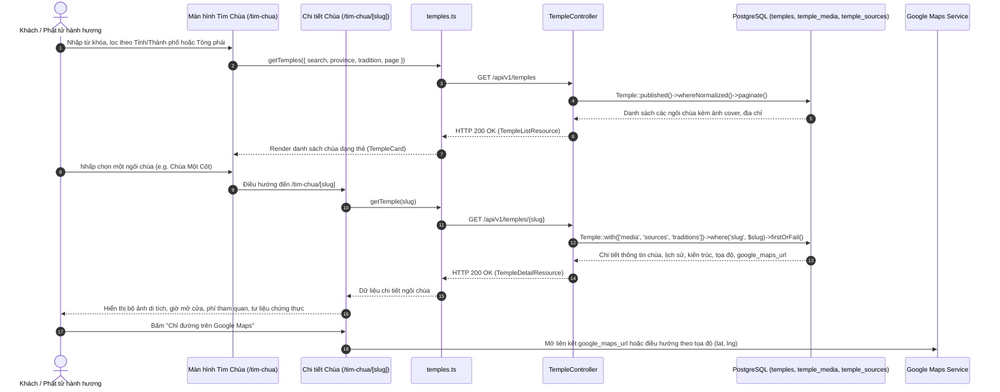

# SƠ ĐỒ TUẦN TỰ: TRA CỨU DANH BẠ CHÙA & BẢN ĐỒ CHỈ ĐƯỜNG (M13.01, M13.02)

---

### Thuyết minh nghiệp vụ

**Tên chức năng:** Tra cứu danh bạ chùa, tu viện và chỉ đường hành hương.

**Mã chức năng:** M13.01, M13.02

**Mục đích:** Cung cấp cơ sở dữ liệu số hóa các danh lam cổ tự, tịnh xá, tu viện Phật giáo tại Việt Nam với thông tin lịch sử đã kiểm chứng, hỗ trợ Phật tử tìm kiếm địa điểm chiêm bái và hành hương.

**Tác nhân:** Khách truy cập hoặc Người dùng.

**Điều kiện tiên quyết:** Chùa đã được ban quản trị thẩm định thông tin và xuất bản (`publication_status = 'published'`).

**Luồng xử lý chính:**
1. Người dùng mở trang `/tim-chua`, chọn các tiêu chí tìm kiếm: tỉnh/thành phố, tông phái, tên chùa.
2. `TempleController::index` sử dụng trường tìm kiếm chuẩn hóa không dấu (`normalized_name`, `normalized_alternative_names`) qua [SearchNormalizer.php](file:///f:/Ompramani/ompramani-api/app/Services/Search/SearchNormalizer.php) để tăng tốc độ và độ chính xác khi tìm kiếm tiếng Việt.
3. Khi bấm vào xem một ngôi chùa cụ thể, hệ thống gọi `GET /api/v1/temples/{slug}`.
4. Nạp đầy đủ thông tin: lịch sử hình thành, nét đẹp văn hóa kiến trúc, quy định tham quan, bộ sưu tập hình ảnh (`temple_media`) và các nguồn tài liệu trích dẫn (`temple_sources`).
5. Trang chi tiết cung cấp nút bấm "Chỉ đường" dẫn thẳng đến liên kết Google Maps hoặc tọa độ vệ tinh GPS đã được chuẩn hóa.

**Luồng ngoại lệ:**
- Nếu chùa chưa được duyệt thông tin: Hệ thống trả về lỗi 404 để bảo vệ tính chính xác của dữ liệu danh bạ.

**Kết quả:** Người dùng nắm rõ lịch sử, địa chỉ và cách thức di chuyển đến ngôi chùa mong muốn.

**Các file source code liên quan:**
- Frontend: `src/app/tim-chua/page.tsx`, `src/app/tim-chua/[slug]/page.tsx`, `src/components/temples/TempleHero.tsx`, `src/lib/api/temples.ts`.
- Backend: `app/Http/Controllers/Api/V1/TempleController.php`, `app/Models/Temple.php`, `app/Models/TempleMedia.php`, `app/Models/TempleSource.php`.
