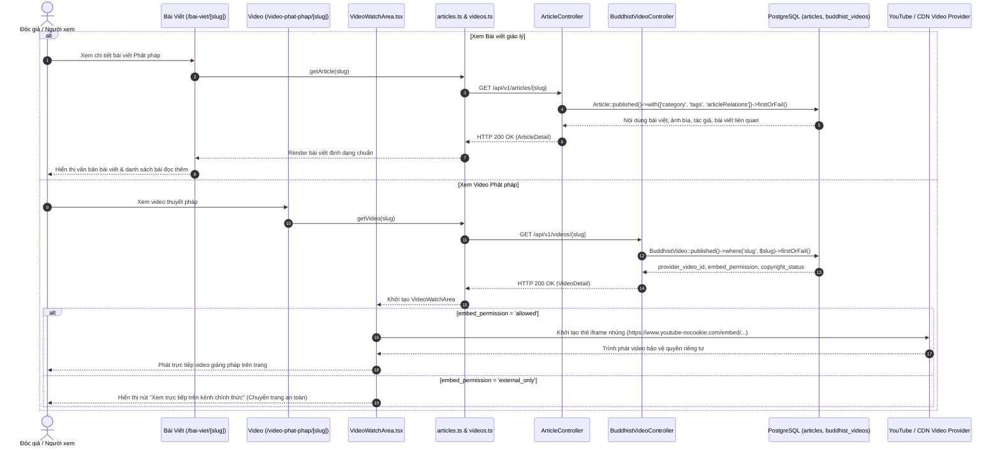

# SƠ ĐỒ TUẦN TỰ: TRA CỨU BÀI VIẾT GIÁO LÝ & THƯ VIỆN VIDEO (M14.01, M14.02)

---

### Thuyết minh nghiệp vụ

**Tên chức năng:** Tra cứu bài viết giáo lý và phát video Phật pháp có kiểm soát bản quyền.

**Mã chức năng:** M14.01, M14.02

**Mục đích:** Cung cấp nguồn tài liệu học Phật đa phương tiện (văn bản bài viết và video bài giảng) chuẩn mực giáo lý, có trích dẫn nguồn gốc và tôn trọng bản quyền tác giả.

**Tác nhân:** Mọi đối tượng người dùng.

**Điều kiện tiên quyết:** Nội dung đã được duyệt xuất bản (`status = 'published'` hoặc `editorial_status = 'published'`).

**Luồng xử lý chính:**
1. **Đối với bài viết giáo lý (`/bai-viet/[slug]`):**
   - Hệ thống tải bài viết qua `ArticleController::show`.
   - Nạp các mối quan hệ liên kết bài đọc thêm (`ArticleRelation`) để độc giả mở rộng hiểu biết theo chủ đề.
2. **Đối với video Phật pháp (`/video-phat-phap/[slug]`):**
   - Hệ thống kiểm tra quyền nhúng (`embed_permission`) và bản quyền (`copyright_status`).
   - Nếu được phép nhúng (`allowed`), `VideoWatchArea.tsx` tạo iframe YouTube sử dụng miền `youtube-nocookie.com` nhằm bảo vệ dữ liệu người dùng.
   - Nếu chỉ cho phép xem tại nguồn (`external_only`), hệ thống hiển thị nút chuyển hướng sang kênh chính thức của giảng sư, không vi phạm chính sách của nhà sản xuất nội dung.

**Luồng ngoại lệ:**
- Bài viết hoặc video chưa được phê duyệt: Trả về lỗi 404 Không tìm thấy.

**Kết quả:** Độc giả tiếp thu giáo lý Phật học qua các bài viết và video chất lượng cao.

**Các file source code liên quan:**
- Frontend: `src/app/bai-viet/[slug]/page.tsx`, `src/app/video-phat-phap/[slug]/page.tsx`, `src/components/videos/VideoWatchArea.tsx`, `src/lib/api/articles.ts`, `src/lib/api/videos.ts`.
- Backend: `app/Http/Controllers/Api/V1/ArticleController.php`, `app/Http/Controllers/Api/V1/BuddhistVideoController.php`, `app/Models/Article.php`, `app/Models/BuddhistVideo.php`.
