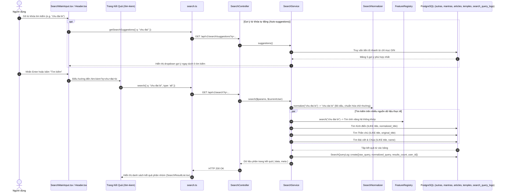

# SƠ ĐỒ TUẦN TỰ: TÌM KIẾM TOÀN CỤC ĐA THỰC THỂ (M15.01, M15.02)

---

### Thuyết minh nghiệp vụ

**Tên chức năng:** Tìm kiếm toàn cục đa thực thể và gợi ý từ khóa thông minh.

**Mã chức năng:** M15.01, M15.02

**Mục đích:** Giúp người dùng nhanh chóng tiếp cận bất kỳ nội dung nào trên nền tảng (kinh điển, thần chú, bài viết, địa chỉ chùa hoặc tính năng hệ thống) chỉ với một ô tìm kiếm duy nhất.

**Tác nhân:** Mọi đối tượng người dùng.

**Điều kiện tiên quyết:** Không yêu cầu đăng nhập.

**Luồng xử lý chính:**
1. Khi người dùng gõ từ khóa vào thanh tìm kiếm, hệ thống kích hoạt API gợi ý `GET /api/v1/search/suggestions` với debounce 300ms để hiển thị các cụm từ phổ biến.
2. Khi người dùng xác nhận tìm kiếm, trang `/tim-kiem` gọi API `GET /api/v1/search`.
3. `SearchNormalizer::normalize` loại bỏ dấu tiếng Việt, chuyển chữ thường và lọc bỏ các ký tự đặc biệt gây lỗi câu lệnh SQL.
4. `SearchService::search` điều phối tìm kiếm đa thực thể:
   - Tra cứu trong `FeatureRegistry` xem từ khóa có trùng với tính năng (ví dụ gõ "chuông mõ" sẽ gợi ý ngay đường dẫn `/chuong-mo`).
   - Truy vấn song song trên các bảng `sutras`, `mantras`, `articles`, `temples`, `buddhist_figures`.
5. Tự động ghi vết vào bảng `search_query_logs` (lưu từ khóa thô, từ khóa chuẩn hóa, số lượng kết quả tìm thấy và ID người dùng nếu có) để phục vụ việc tối ưu hóa nội dung sau này.
6. Kết quả được định dạng thống nhất trả về hiển thị dạng thẻ trên giao diện.

**Luồng ngoại lệ:**
- Từ khóa rỗng: Trả về danh sách rỗng với tổng số kết quả bằng 0 mà không thực hiện truy vấn nặng nề vào database.

**Kết quả:** Người dùng tìm thấy chính xác nội dung mong muốn trên toàn hệ thống.

**Các file source code liên quan:**
- Frontend: `src/app/tim-kiem/page.tsx`, `src/components/search/SearchMainInput.tsx`, `src/components/search/SearchResultList.tsx`, `src/lib/api/search.ts`.
- Backend: `app/Http/Controllers/Api/V1/SearchController.php`, `app/Services/Search/SearchService.php`, `app/Services/Search/SearchNormalizer.php`, `app/Support/Search/FeatureRegistry.php`, `app/Models/SearchQueryLog.php`.
