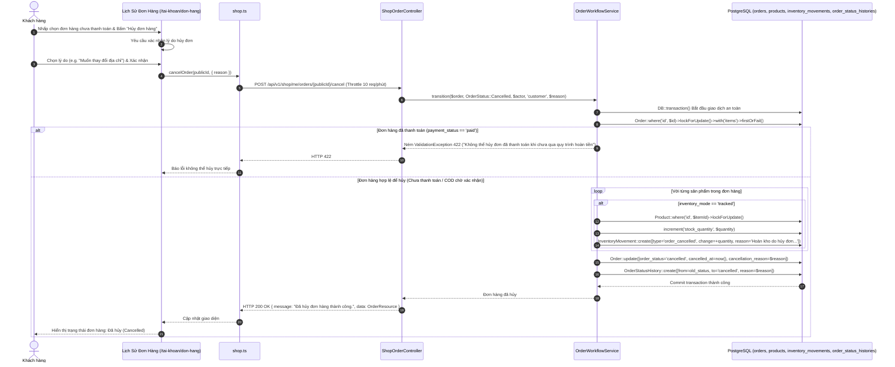

# SƠ ĐỒ TUẦN TỰ: HỦY ĐƠN HÀNG & TỰ ĐỘNG HOÀN TRẢ TỒN KHO (M16.11)

---

### Thuyết minh nghiệp vụ

**Tên chức năng:** Khách hàng hủy đơn hàng và hệ thống tự động hoàn trả tồn kho.

**Mã chức năng:** M16.11

**Mục đích:** Cho phép khách hàng chủ động hủy các đơn hàng chưa thanh toán hoặc nhầm lẫn thông tin; hệ thống tự động cộng trả lại số lượng tồn kho của sản phẩm để người khác có thể mua, duy trì tính chính xác của kho hàng.

**Tác nhân:** Người dùng sở hữu đơn hàng.

**Điều kiện tiên quyết:** Đơn hàng thuộc quyền sở hữu của người dùng đang đăng nhập (`OrderPolicy`), đơn hàng chưa thanh toán tiền (`payment_status != 'paid'`) và trạng thái đơn cho phép hủy theo máy trạng thái `canTransitionTo(OrderStatus::Cancelled)`.

**Luồng xử lý chính:**
1. Người dùng mở trang quản lý đơn hàng `/tai-khoan/don-hang`, bấm nút "Hủy đơn" trên đơn hàng đang chờ xử lý.
2. Gửi request `POST /api/v1/shop/me/orders/{publicId}/cancel` kèm lý do hủy.
3. `OrderWorkflowService::transition` thực thi chuyển đổi trạng thái trong một `DB::transaction()` có khóa bi quan `lockForUpdate()`.
4. Kiểm tra điều kiện an toàn: Nếu đơn hàng đã thanh toán, hệ thống kiên quyết từ chối hủy trực tiếp để bảo vệ dòng tiền, yêu cầu liên hệ ban quản trị để thực hiện quy trình hoàn tiền (`refund`).
5. Nếu đơn hợp lệ: Duyệt qua từng sản phẩm trong đơn, với các sản phẩm có quản lý tồn kho (`inventory_mode === 'tracked'`), hệ thống tự động cộng ngược số lượng (`increment`) vào bảng `products`.
6. Tạo một bản ghi biến động kho trong bảng `inventory_movements` với loại hành động `order_cancelled` và số lượng dương (`change = +quantity`).
7. Cập nhật `order_status = 'cancelled'`, ghi nhận thời điểm hủy `cancelled_at = now()` và lý do hủy.
8. Ghi log trạng thái chuyển đổi vào bảng `order_status_histories`.

**Luồng ngoại lệ:**
- Người dùng cố tình hủy đơn hàng của người khác: Bị chặn bởi `OrderPolicy` với mã lỗi 403 Forbidden.

**Kết quả:** Đơn hàng chuyển sang trạng thái đã hủy, toàn bộ số lượng sản phẩm được hoàn lại vào kho ngay lập tức.

**Các file source code liên quan:**
- Frontend: `src/app/tai-khoan/don-hang/page.tsx`, `src/lib/api/shop.ts`.
- Backend: `app/Services/Shop/OrderWorkflowService.php` (dòng 58-96), `app/Http/Controllers/Api/V1/ShopOrderController.php`, `app/Policies/OrderPolicy.php`, `app/Models/InventoryMovement.php`.
