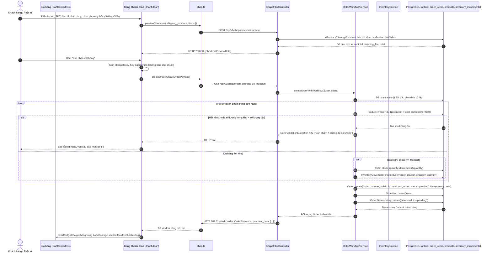

# SƠ ĐỒ TUẦN TỰ: TẠO ĐƠN HÀNG & KHÓA TRỪ TỒN KHO BI QUAN (M16.04, M16.05)

---

### Thuyết minh nghiệp vụ

**Tên chức năng:** Đặt đơn hàng mới kèm khóa tồn kho bi quan và bảo vệ Idempotency.

**Mã chức năng:** M16.04, M16.05

**Mục đích:** Xử lý tạo đơn hàng pháp bảo an toàn tuyệt đối trong môi trường đồng thời cao; đảm bảo không bao giờ bị bán quá số lượng tồn kho (overselling) và không bị tạo trùng đơn hàng khi người dùng nhấn nút nhiều lần.

**Tác nhân:** Người dùng đã đăng nhập.

**Điều kiện tiên quyết:** Giỏ hàng có ít nhất 1 sản phẩm hợp lệ, người dùng đã đăng nhập.

**Luồng xử lý chính:**
1. Khách hàng nhập thông tin nhận hàng tại `/thanh-toan`.
2. Frontend gọi `POST /api/v1/shop/checkout/preview` để máy chủ thẩm định lại giá từng sản phẩm, kiểm tra còn hàng và tính toán cước phí vận chuyển chính xác theo tỉnh/thành (`ShippingFeePolicy`).
3. Frontend tạo một khóa bất biến `idempotency_key` (dạng `idem_{timestamp}_{random}`).
4. Gửi `POST /api/v1/shop/orders` có giới hạn tần suất 10 lần/phút.
5. `OrderWorkflowService` mở một `DB::transaction()` và áp dụng kỹ thuật khóa dòng bi quan `lockForUpdate()` trên từng bản ghi `Product`.
6. Kiểm tra số lượng tồn kho: Nếu chế độ tồn kho là `Tracked` (`inventory_mode == 'tracked'`), hệ thống trừ trực tiếp số lượng tồn và tạo bản ghi lịch sử biến động kho trong bảng `inventory_movements`.
7. Tạo bản ghi đơn hàng trong bảng `orders` (mã công khai `public_id` dạng ULID, mã đơn hàng `order_number` dạng `OPM-YYMMDD-XXXX`), lưu danh sách sản phẩm vào `order_items`.
8. Ghi log trạng thái ban đầu `pending` vào bảng `order_status_histories`.
9. Khi đơn hàng tạo thành công, giỏ hàng `CartContext` tự động được dọn sạch khỏi `localStorage`.

**Luồng ngoại lệ:**
- Nếu một sản phẩm trong giỏ bị hết hàng trong lúc đặt: Giao dịch Database tự động Rollback nguyên vẹn, trả về lỗi 422 thông báo rõ sản phẩm bị thiếu.

**Kết quả:** Đơn hàng được tạo thành công, tồn kho được trừ an toàn, sẵn sàng bước vào quy trình thanh toán.

**Các file source code liên quan:**
- Frontend: `src/app/thanh-toan/CheckoutClient.tsx`, `src/context/CartContext.tsx`, `src/lib/api/shop.ts`.
- Backend: `app/Http/Controllers/Api/V1/ShopOrderController.php` (hàm `store`), `app/Services/Shop/OrderWorkflowService.php`, `app/Services/Shop/InventoryService.php`, `app/Models/Order.php`, `app/Models/Product.php`.
