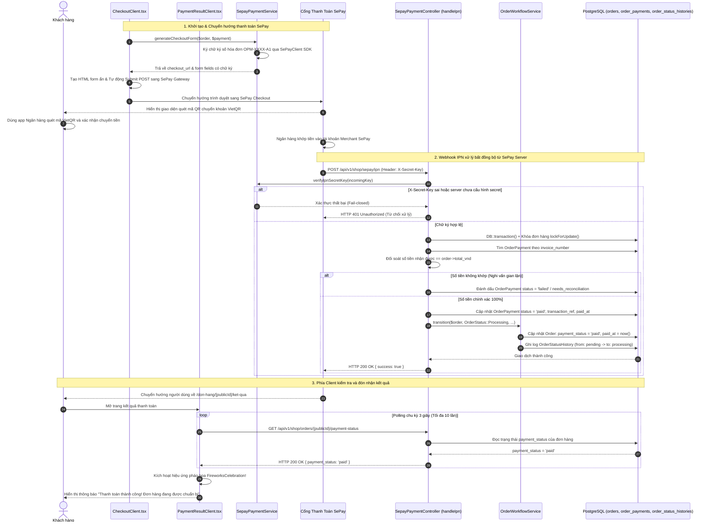

# SƠ ĐỒ TUẦN TỰ: THANH TOÁN SEPAY VIETQR & XỬ LÝ WEBHOOK IPN (M16.06, M16.07, M16.08)

---

### Thuyết minh nghiệp vụ

**Tên chức năng:** Khởi tạo thanh toán VietQR qua SePay, tiếp nhận Webhook IPN và Polling trạng thái.

**Mã chức năng:** M16.06, M16.07, M16.08

**Mục đích:** Tự động hóa 100% quy trình thu tiền chuyển khoản ngân hàng qua mã VietQR động, đối chiếu tiền về tức thời và kích hoạt quy trình đóng gói đơn hàng.

**Tác nhân:** Khách hàng (Thanh toán), Hệ thống SePay (Bắn Webhook) và Máy chủ OmPraMani.

**Điều kiện tiên quyết:** Đơn hàng đã được tạo thành công với phương thức thanh toán `sepay`.

**Luồng xử lý chính:**
1. Khi đơn hàng được tạo, `SepayPaymentService::generateCheckoutForm` sử dụng SDK chính thức của SePay để ký số các trường thanh toán với mã hóa đơn duy nhất dạng `OPM-{order_number}-A{attempt_number}`.
2. Trình duyệt tự động tạo và submit một form POST ẩn điều hướng khách hàng sang cổng thanh toán SePay để quét mã VietQR.
3. Khi khách hàng chuyển khoản thành công từ app ngân hàng, máy chủ SePay gửi một gói tin Instant Payment Notification (IPN) đến endpoint `POST /api/v1/shop/sepay/ipn`.
4. `SepayPaymentController::handleIpn` thực thi nguyên tắc an ninh **Fail-closed**:
   - Bắt buộc kiểm tra header `X-Secret-Key` khớp với khóa bí mật `SEPAY_IPN_SECRET_KEY` đã cấu hình trên server. Nếu thiếu hoặc sai, từ chối ngay với mã lỗi 401.
5. Mở `DB::transaction()` và khóa bi quan bản ghi đơn hàng.
6. So sánh số tiền thực nhận trong IPN (`transaction_amount`) với tổng giá trị đơn hàng (`order->total_vnd`). Nếu khớp hoàn toàn:
   - Cập nhật bản ghi `order_payments` thành `paid`.
   - Cập nhật trạng thái đơn hàng sang `Processing` (Đang chuẩn bị hàng) và `payment_status = 'paid'`, lưu vết vào `order_status_histories`.
7. Trả về mã HTTP 200 xác nhận cho SePay không gửi lại webhook nữa.
8. Trình duyệt khách hàng sau khi chuyển tiền được chuyển hướng về `/don-hang/[publicId]/ket-qua` và thực hiện cơ chế Polling (chu kỳ 3s/lần, tối đa 10 lần) để đón nhận trạng thái `paid`.
9. Khi trạng thái chuyển sang đã thanh toán, giao diện bắn hiệu ứng pháo hoa ăn mừng và hiển thị hóa đơn thanh toán.

**Luồng ngoại lệ:**
- Nếu số tiền thanh toán bị thiếu hoặc sai lệch: Trạng thái đơn được chuyển sang `needs_reconciliation` (cần đối soát thủ công) để nhân viên quản trị xử lý trong Admin.

**Kết quả:** Đơn hàng được thanh toán tự động, không cần chụp ảnh màn hình chuyển khoản thủ công.

**Các file source code liên quan:**
- Frontend: `src/app/thanh-toan/CheckoutClient.tsx`, `src/app/don-hang/[publicId]/ket-qua/PaymentResultClient.tsx`, `src/lib/api/shop.ts`.
- Backend: `app/Http/Controllers/Api/V1/SepayPaymentController.php` (các hàm `handleIpn`, `getPaymentStatus`), `app/Services/Shop/SepayPaymentService.php`, `app/Services/Shop/OrderWorkflowService.php`, `app/Models/OrderPayment.php`.
