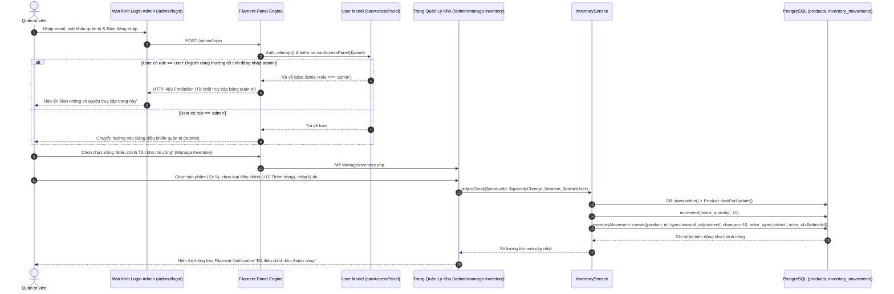

# SƠ ĐỒ TUẦN TỰ: KIỂM SOÁT QUYỀN & QUẢN TRỊ TRÊN FILAMENT ADMIN (M17.01)



---

### Thuyết minh nghiệp vụ

**Tên chức năng:** Kiểm soát quyền truy cập Admin Panel và điều chỉnh tồn kho vật phẩm thủ công.

**Mã chức năng:** M17.01, M16.12

**Mục đích:** Bảo vệ hệ thống quản trị chỉ dành riêng cho các tài khoản được ủy thác đặc quyền (`role = 'admin'`), hỗ trợ thủ kho cập nhật số lượng nhập kho mới hoặc kiểm kê định kỳ với đầy đủ vết kiểm toán.

**Tác nhân:** Quản trị viên hệ thống (Admin).

**Điều kiện tiên quyết:** Tài khoản trong bảng `users` có cột `role = 'admin'`.

**Luồng xử lý chính:**
1. Quản trị viên truy cập `/admin/login`.
2. Filament kiểm tra hợp lệ thông tin qua phương thức `canAccessPanel(Panel $panel): bool` cài đặt trên `User` model:
   ```php
   public function canAccessPanel(Panel $panel): bool {
       return $this->role === 'admin';
   }
   ```
3. Nếu tài khoản chỉ là người dùng thông thường (`role === 'user'`), Filament lập tức từ chối với mã lỗi 403 Forbidden.
4. Khi đã đăng nhập, quản trị viên có thể truy cập các trang chuyên biệt như `/admin/manage-inventory`.
5. Tại đây, khi điều chỉnh tồn kho (nhập hàng mới, hao hụt, mất mát...), `InventoryService` chạy giao dịch database khóa bi quan dòng sản phẩm, cập nhật `stock_quantity` và lưu bản ghi lịch sử `inventory_movements` ghi rõ ID quản trị viên thực hiện.

**Luồng ngoại lệ:**
- Người dùng chưa đăng nhập cố truy cập `/admin`: Tự động bị chuyển hướng về màn hình đăng nhập `/admin/login`.

**Kết quả:** Kho hàng được cập nhật chính xác, mọi hành động quản trị đều được lưu vết chi tiết.

**Các file source code liên quan:**
- Backend: `app/Models/User.php` (hàm `canAccessPanel`), `app/Filament/Pages/ManageInventory.php`, `app/Services/Shop/InventoryService.php`, `app/Models/InventoryMovement.php`.
