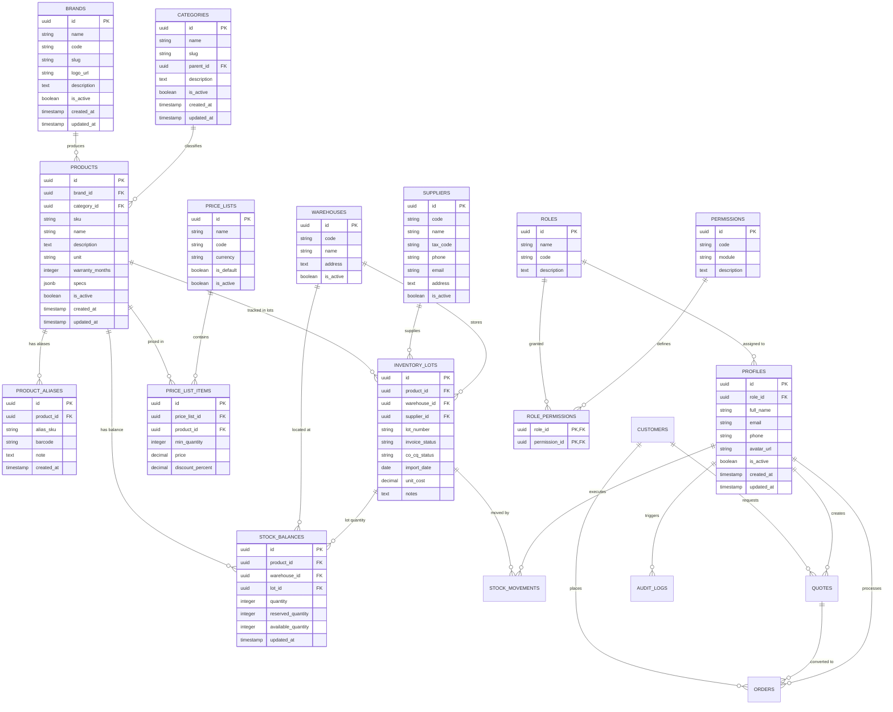

# Thiết Kế Cơ Sở Dữ Liệu & ERD - IT Equipment Warehouse (Sprint 01)

## 1. Triết Lý Thiết Kế Dữ Liệu

### 1.1 Phân Biệt Master SKU & Tồn Kho Theo Lô (Inventory Lots)
Trong ngành phân phối thiết bị phần cứng mạng & máy chủ (Cisco, Aruba, Fortinet...), một mã sản phẩm (Part Number / SKU) như `C9200-48T-E` là định danh kỹ thuật chuẩn mực của hãng. Tuy nhiên:
- Công ty có thể nhập 5 chiếc từ Nhà cung cấp A (có đủ CO/CQ từ nhà máy, hóa đơn VAT 10%, giá nhập $1,800/chiếc).
- Nhập 3 chiếc từ Nhà cung cấp B (hàng dự án tồn kho chuyển nhượng, hóa đơn trực tiếp, giá nhập $1,650/chiếc).
- **Quy tắc tuyệt đối**: Không dùng màu sắc trong bảng tính Excel để phân biệt tình trạng hàng. Toàn bộ thông tin này phải được chuẩn hóa vào các trường dữ liệu cụ thể (`invoice_status`, `co_cq_status`, `supplier_id`, `unit_cost`, `lot_number`).
- Bảng `products` quản lý thông tin danh mục gốc (Part Number, Hãng, Danh mục, Thông số kỹ thuật, Thời hạn bảo hành tiêu chuẩn).
- Bảng `inventory_lots` và `stock_balances` quản lý số lượng tồn theo từng lô hàng cụ thể tại từng kho.

### 1.2 Ràng Buộc Tính Duy Nhất của SKU
- SKU là duy nhất **theo từng thương hiệu** (`UNIQUE (brand_id, sku)`). Lý do: Một số hãng phụ kiện hoặc cáp có thể trùng mã quy ước ngắn với hãng khác, nhưng trong cùng một hãng thì Part Number là duy nhất.

---

## 2. Sơ Đồ Quan Hệ Thực Thể (ERD - Full System Vision)

---

## 3. Đặc Tả Chi Tiết Các Bảng Dữ Liệu

### 3.1 Nhóm Bảng Cốt Lõi (Triển Khai Trực Tiếp Trong Sprint 01)

#### 1. `brands` (Thương hiệu thiết bị)
- `id` (UUID, Primary Key, `gen_random_uuid()`)
- `name` (VARCHAR(100), NOT NULL) - Ví dụ: "Cisco Systems", "HPE Aruba", "Fortinet"
- `code` (VARCHAR(50), NOT NULL, UNIQUE) - Ví dụ: "CISCO", "ARUBA", "FORTINET"
- `slug` (VARCHAR(100), NOT NULL, UNIQUE) - Ví dụ: "cisco", "hpe-aruba", "fortinet"
- `logo_url` (VARCHAR(255), NULL)
- `description` (TEXT, NULL)
- `is_active` (BOOLEAN, DEFAULT TRUE, NOT NULL)
- `created_at` (TIMESTAMPTZ, DEFAULT NOW(), NOT NULL)
- `updated_at` (TIMESTAMPTZ, DEFAULT NOW(), NOT NULL)
- **Indexes**: `idx_brands_slug`, `idx_brands_code`

#### 2. `categories` (Danh mục phân loại thiết bị)
- `id` (UUID, Primary Key, `gen_random_uuid()`)
- `name` (VARCHAR(100), NOT NULL) - Ví dụ: "Switch", "Firewall", "Router", "Transceiver", "Server"
- `slug` (VARCHAR(100), NOT NULL, UNIQUE)
- `parent_id` (UUID, NULL, REFERENCES `categories(id)` ON DELETE SET NULL)
- `description` (TEXT, NULL)
- `is_active` (BOOLEAN, DEFAULT TRUE, NOT NULL)
- `created_at` (TIMESTAMPTZ, DEFAULT NOW(), NOT NULL)
- `updated_at` (TIMESTAMPTZ, DEFAULT NOW(), NOT NULL)
- **Indexes**: `idx_categories_slug`, `idx_categories_parent_id`

#### 3. `products` (Danh mục SKU / Master Products)
- `id` (UUID, Primary Key, `gen_random_uuid()`)
- `brand_id` (UUID, NOT NULL, REFERENCES `brands(id)` ON DELETE RESTRICT)
- `category_id` (UUID, NULL, REFERENCES `categories(id)` ON DELETE SET NULL)
- `sku` (VARCHAR(100), NOT NULL) - Ví dụ: "C9200-48T-E", "WS-C2960CX-8PC-L", "FG-60F"
- `name` (VARCHAR(255), NOT NULL) - Tên thiết bị đầy đủ
- `description` (TEXT, NULL) - Mô tả tính năng, cổng kết nối
- `unit` (VARCHAR(30), DEFAULT 'Cái', NOT NULL) - Đơn vị tính
- `warranty_months` (INTEGER, DEFAULT 12, NOT NULL) - Thời gian bảo hành chính hãng
- `specs` (JSONB, DEFAULT '{}', NOT NULL) - Thuộc tính linh hoạt (ports, poe_budget, throughput, form_factor...)
- `is_active` (BOOLEAN, DEFAULT TRUE, NOT NULL)
- `created_at` (TIMESTAMPTZ, DEFAULT NOW(), NOT NULL)
- `updated_at` (TIMESTAMPTZ, DEFAULT NOW(), NOT NULL)
- **Constraints & Indexes**:
  - `UNIQUE (brand_id, sku)` - Bảo đảm tính duy nhất của SKU theo từng hãng
  - `idx_products_sku` - Tìm kiếm nhanh theo Part Number
  - `idx_products_brand_id` - Lọc sản phẩm theo hãng
  - `idx_products_category_id` - Lọc sản phẩm theo danh mục
  - `idx_products_name_trgm` (hoặc btree) - Hỗ trợ tìm kiếm theo tên

#### 4. `roles` (Vai trò người dùng)
- `id` (UUID, Primary Key, `gen_random_uuid()`)
- `name` (VARCHAR(50), NOT NULL) - "Quản trị viên", "Thủ kho", "Nhân viên kinh doanh"
- `code` (VARCHAR(30), NOT NULL, UNIQUE) - `admin`, `warehouse`, `sale`
- `description` (TEXT, NULL)
- `created_at` (TIMESTAMPTZ, DEFAULT NOW(), NOT NULL)
- `updated_at` (TIMESTAMPTZ, DEFAULT NOW(), NOT NULL)

#### 5. `permissions` (Định nghĩa quyền chức năng)
- `id` (UUID, Primary Key, `gen_random_uuid()`)
- `name` (VARCHAR(100), NOT NULL)
- `code` (VARCHAR(50), NOT NULL, UNIQUE) - Ví dụ: `products:read`, `products:create`, `inventory:manage`
- `module` (VARCHAR(50), NOT NULL) - "products", "brands", "inventory", "prices", "orders"
- `description` (TEXT, NULL)
- `created_at` (TIMESTAMPTZ, DEFAULT NOW(), NOT NULL)

#### 6. `role_permissions` (Bảng liên kết Nhiều - Nhiều giữa Roles và Permissions)
- `role_id` (UUID, NOT NULL, REFERENCES `roles(id)` ON DELETE CASCADE)
- `permission_id` (UUID, NOT NULL, REFERENCES `permissions(id)` ON DELETE CASCADE)
- `created_at` (TIMESTAMPTZ, DEFAULT NOW(), NOT NULL)
- **Primary Key**: `(role_id, permission_id)`

#### 7. `profiles` (Hồ sơ người dùng kết nối với Supabase Auth)
- `id` (UUID, Primary Key) - Khớp với `auth.users(id)` của Supabase Auth
- `role_id` (UUID, NOT NULL, REFERENCES `roles(id)` ON DELETE RESTRICT)
- `full_name` (VARCHAR(100), NOT NULL)
- `email` (VARCHAR(255), NOT NULL, UNIQUE)
- `phone` (VARCHAR(20), NULL)
- `avatar_url` (VARCHAR(255), NULL)
- `is_active` (BOOLEAN, DEFAULT TRUE, NOT NULL)
- `created_at` (TIMESTAMPTZ, DEFAULT NOW(), NOT NULL)
- `updated_at` (TIMESTAMPTZ, DEFAULT NOW(), NOT NULL)
- **Indexes**: `idx_profiles_role_id`, `idx_profiles_email`

---

### 3.2 Nhóm Bảng Mở Rộng (Kế Hoạch Sprint 02 & Sprint 03)

1. **`product_aliases`**: Mã thay thế, mã tương đương, barcode SKU.
2. **`suppliers`**: Thông tin nhà phân phối/nhập khẩu (Tên, MST, Số điện thoại, Email, Địa chỉ).
3. **`warehouses`**: Danh mục kho hàng vật lý (Kho Hà Nội, Kho TP.HCM, Kho Dự Án).
4. **`inventory_lots`**: Quản lý từng lô hàng nhập về (Mã lô, SKU, Kho, NCC, Hóa đơn VAT [co_vat/khong_vat/hoa_don_truc_tiep], CO/CQ [chinh_hang_hang_hoa/dang_cho/khong_co], Giá nhập).
5. **`stock_balances`**: Tồn kho khả dụng thời gian thực theo từng SKU + Lô + Kho.
6. **`stock_movements`**: Lịch sử nhập, xuất, chuyển kho và lý do điều chuyển.
7. **`stock_reservations`**: Giữ chỗ hàng khi nhân viên Sale tạo báo giá hoặc giữ hàng dự án (có thời hạn hết hạn).
8. **`price_lists` & `price_list_items`**: Bảng giá bán lẻ, bảng giá đại lý Gold/Silver, bảng giá dự án đặc thù.
9. **`customers`**: Thông tin khách hàng doanh nghiệp, đại lý bán lại (SI) và dự án.
10. **`quotes` & `orders`**: Báo giá và đơn đặt hàng xuất bán.
11. **`audit_logs`**: Ghi nhận toàn bộ thao tác sửa đổi giá, sửa số lượng tồn, cập nhật SKU để phục vụ kiểm toán nội bộ.
